# Aayatun — Architecture

Aayatun is a server-rendered Quran reader: **Flask 2.3 + Jinja2**, SQLite and JSON
data files, and CDN-hosted jQuery/Fomantic on the front end. There is no build
step, no bundler, no npm, and no test suite. `app.py` holds every route,
`library.py` is the single data-access layer, `templates/` renders HTML, and
`static/js/` adds the interactive layers (carousel, mushaf view, share cards,
reading map).

This document maps every moving part: the process, the routes, the library
layers, each data store, the template hierarchy, the client modules, the service
worker, the external APIs, and the offline generation tooling.

**Reading order for a new contributor**

1. [System at a glance](#1-system-at-a-glance)
2. [Request lifecycle](#2-process-boot-and-request-lifecycle)
3. [Routes](#3-route-map)
4. [library.py](#4-librarypy--the-data-layer)
5. [Data stores](#5-data-stores)
6. [Templates](#6-template-layer)
7. [Client-side JavaScript](#7-client-side-javascript)
8. [Service worker & offline](#8-service-worker-pwa-and-offline)
9. [External services](#9-external-services-and-failure-policy)
10. [Caching](#10-caching-model)
11. [Security](#11-security-and-privacy)

---

## 1. System at a glance

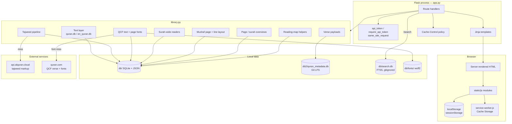

**Design principles**

- **SSR first.** Every reading view works without JavaScript: the verse page,
  surah views and mushaf pages are complete HTML. JS upgrades navigation,
  toggles, sharing and the map.
- **One data layer.** Routes never open a database; they call `library.py`.
- **Local data is authoritative.** The Quran text, translations, tafsir,
  metadata, QCF seed and mushaf layout are shipped in the repo. Network calls
  only add colour (tajweed) and the per-page QCF fonts, and each has a local
  cache plus a safe fallback.
- **Prebuilt content.** AI overviews, the search index (`db/search.db`,
  generated by `build_search.py` from local DBs and gitignored), the QCF seed
  and the mushaf line layout are produced offline.
- **Layered caching.** In-process dicts and `lru_cache` → on-disk SQLite/font
  caches → HTTP caching → service worker → `localStorage`. Each layer is
  described in [§10](#10-caching-model).

---

## 2. Process boot and request lifecycle

### 2.1 Boot sequence

`app.py` has no `__main__` block; it is started by the Flask CLI
(`flask --app app.py run`). Import time does the following:

| Step | Where | What happens |
|---|---|---|
| 1 | `app.py` imports | `pandas`, `library`, `searchtool`, `gzip`, `hmac`, `secrets` … |
| 2 | module level | `RUKU_LIST = getRukuList()` parses `db/ruku_index.txt` with `ast.literal_eval`. It is used by **Surprise me!** and the index. |
| 3 | `library` import | `db/pos_tags_dict.txt` is read with `eval()` into `pos_tags`; `roman_number` table is built. |
| 4 | `load_secret_key()` | Uses `AAYATUN_SECRET_KEY` if set, otherwise an atomically created `db/.secret_key` (generated once, gitignored) so sessions survive restarts and are shared by workers on one host. Falls back to an ephemeral key on a read-only filesystem. |
| 5 | `app.config.update` | `SESSION_COOKIE_HTTPONLY`, `SAMESITE=Lax`, and `SECURE` when `AAYATUN_HTTPS=1`. |
| 6 | first request | Text tables, QCF seed, mushaf JSON, overviews and fonts are loaded lazily on first use (each guarded by a lock), so boot stays instant. |

The index page's random ruku is chosen at **request** time (`random.choice`),
so page responses stay cacheable; the map-versus-ruku branch for
**Surprise me!** is chosen in the browser.

### 2.2 Request pipeline


- Flask's default static route serves `/static/*`.
- `/service-worker.js` is served explicitly from `static/` so it lives at the
  origin root (required for its scope).
- The nav API is session-bound. A page that embeds the token must never be
  stored by a shared cache, hence `private_page()`
  (`private, max-age=0, must-revalidate`). API JSON uses `no_store()`
  (`private, no-store`). Musshaf pages get `private, max-age=300`; fonts get
  `public, max-age=31536000, immutable`.
- There are no blueprints, no middleware chain and no error handlers beyond
  Werkzeug's defaults. `abort(404)` / `abort(403)` are the error path.

**Run and smoke test**

```bash
pip install -r requirements.txt
git lfs pull                     # db2/quran_metadata.db (~311 MB)
flask --app app.py run --debug   # from the repo root; data paths are relative
python3 -c "import app; print(app.app.test_client().get('/2/255').status_code)"
```

Python files use **tabs** for indentation. `db2` is Git LFS; without it, verse
pages raise `KeyError` in `get_verse_pickle`.

---

## 3. Route map

All routes live in `app.py` (flat, no blueprints).

| Method | Path | Handler | Renders / returns | Auth | Cache-Control |
|---|---|---|---|---|---|
| GET | `/` | `index` | `index.html` with surah list, random ruku, page bounds | — | default |
| GET | `/<surah>/` | `details2` | `versedetails.html` with **full** details of verse 1 | — | `private, max-age=0, must-revalidate` |
| GET | `/<surah>/<verse>` | `details` | `versedetails.html` with **core** payload | — | `private, max-age=0, must-revalidate` |
| GET | `/<surah>/<verse>` (strict-slashes off) | same | same | — | same |
| POST | `/search/` | `search` | `search.html` with FTS5 results | — | default |
| GET | `/translation/<surah>` | `translation` | `translation.html` (`comprehensive.html`) | — | default |
| GET | `/tafsir/en/<surah>` | `en_tafsir` | `en_tafsir.html` | — | default |
| GET | `/tafsir/bn/<surah>` | `bn_tafsir` | `bn_tafsir.html` | — | default |
| GET | `/mushaf/<surah>` | `arabic_fulltext` | `arabic_fulltext.html` | — | default |
| GET | `/page/<1..604>` | `mushaf_page` | `mushaf_page.html` (table + printed layout) | — | `private, max-age=300` |
| GET | `/api/v1/verse/<s>/<v>` | `verse_api` | JSON core payload | token + same-site | `private, no-store` |
| GET | `/api/v1/surah/<n>` | `surah_api` | compact gzipped surah payload | — | `no-store`, `Vary: Accept-Encoding` |
| GET | `/api/v1/verse/<s>/<v>/<section>` | `verse_section_api` | HTML partial (`ai`, `wfw`, `defs`, `morph`, `bn`, `en`) | token + same-site | `private, no-store` |
| GET | `/font/v4/<1..604>.woff2` | `qcf_font` | QCF page font bytes | — | `public, max-age=31536000, immutable` |
| GET | `/service-worker.js` | `sw` | `static/service-worker.js` | — | default |
| GET | `/prayer-time` | `prayer_time` | `prayer-time.html` verbatim | — | default |
| GET | `/daily-counter` | `daily_counter` | `daily-counter.html` verbatim | — | default |

Notes:

- The two standalone pages are served with `send_from_directory('.', …)`, so
  they must stay at the repo root. They use no Jinja and no `base.html`.
- `/search` is **POST-only**; the form field is `query_str`, with optional
  `target_field` (a column filter such as `en_tafsir:` — `ayah`,
  `translation`, `en_tafsir`, `bn_tafsir`, `ai`) and `limit` (`-1` =
  unlimited). A query matching `^\d+[:/.-]\d+$` (e.g. `2:255`) redirects
  straight to the verse instead of searching.
- `/<surah>/<verse>` is the hot path; `/<surah>/` is kept for links that point
  at a surah and renders the full first-verse payload instead of the core one.
- `strict_slashes=False` means `/2/255` and `/2/255/` both resolve.

---

## 4. `library.py` — the data layer

`library.py` is ~1,200 lines and is imported by both `app.py` and
`searchtool.py`. Its sections, in file order:

```
 imports, quran_stat, text tables
 tajweed: rules → scan → align → render → cache → warmers
 QCF: seed → cache → page index → fonts → warmers
 tajweed_to_html / get_ayah_tajweed
 per-verse translations / tafsir / morph / word meanings
 legacy getSurahInfo
 surah-wide readers
 RootDefAdder
 verse pickle / p_getSurahInfo
 verse nav core + sections
 surah QCF, mushaf page, mushaf lines
 page/surah overviews
 reading-map helpers (surah_starts, verse_index, page_bounds)
 surah carousel payload
```

### 4.1 Layer view

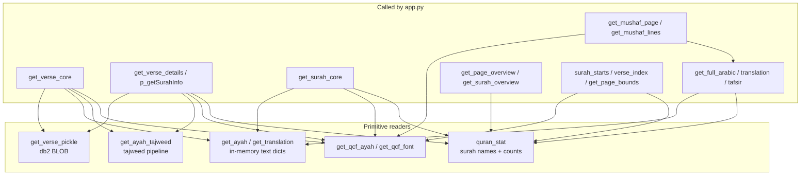

### 4.2 Text layer

`db/quran.db` and `db/en_quran.db` are **FTS3 virtual tables** whose
`where sura = ? and ayah = ?` lookup scans the whole index (hundreds of ms on a
slow disk). Both tables are immutable, so `_load_text_table()` reads all 6,236
rows once into a Python dict `{(surah, verse): text}`, guarded by
`threading.Lock`, and every later lookup is a dict hit.

- Arabic glyphs always come from `get_ayah()` (the local Uthmani text).
  Tajweed only **wraps** those glyphs in colour spans; it never replaces them.
- `db/quran_stat.json` (read into the `quran_stat()` `lru_cache(maxsize=1)`)
  holds `Surah` names and `Verses` counts and is the validation source for
  every route.
- `validate(surah, verse)` is the shared bounds check.

### 4.3 Tajweed pipeline

Tajweed is optional colouring. The source of truth for both text and colours
is still the local DB; the remote edition contributes only rule spans.

**Source format** (`api.alquran.cloud/v1/ayah/{s}:{v}/quran-tajweed`):

```
[h:9421[ٱ]  →  rule "h" (hamzat ul wasl), segment "ٱ"
[n[ۥ]       →  rule "n" (madda normal)
```

Rule letters map to CSS classes via `TAJWEED_RULES` (`h`, `s`, `l`, `n`, `p`,
`m`, `q`, `o`, `c`, `f`, `w`, `i`, `a`, `u`, `d`, `b`, `g`). Colours live in
`static/css/style.css`.

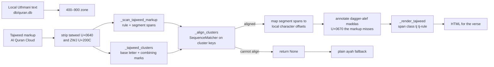

Why clustering: the two editions differ in tatweel joiners, ZWJ and
sukun/rounded-zero variants. Aligning **grapheme clusters** (base character +
contiguous `Mn` marks) rather than codepoints tolerates those differences;
`_cluster_key` normalises them. When alignment fails, `tajweed_to_html`
returns `None` and the caller renders the plain ayah — never broken markup.

**Fetch and cache**

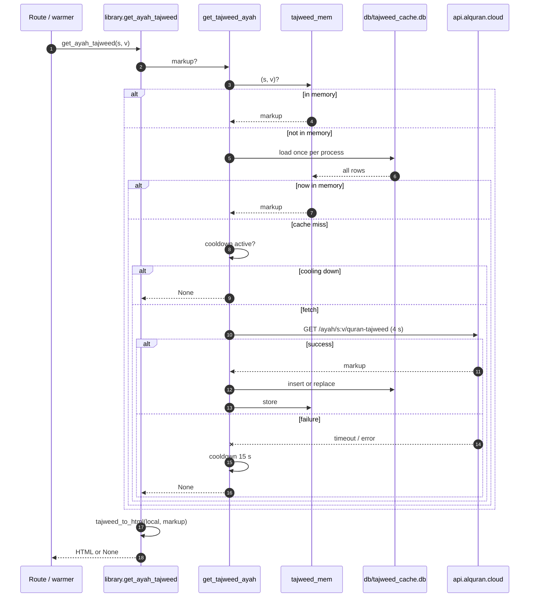

Key properties:

- **Successes are forever**: `lru_cache(maxsize=6236)` on `_fetch_tajweed_ayah`,
  the in-process `tajweed_mem` dict, and the SQLite table.
- **Failures are cheap**: a 4 s timeout and a 15 s global cooldown
  (`tajweed_cooldown`) prevent hammering a down API. The plain ayah is shown
  meanwhile.
- **Warmers**: `warm_tajweed_surah()` / `_preheat_tajweed_surah()` start daemon
  threads that fetch the rest of the surah after a verse is served, so later
  verses render in colour instantly and offline once warmed. A per-process
  `_tajweed_warmed` set prevents duplicate work.
- **No client-side markup generation**: `get_ayah_tajweed` returns final HTML;
  `static/js/qcf-font.js`/`verse-nav.js` only paint it.

### 4.4 QCF (Quran Complex) text and fonts

The coloured mushaf face is King Fahd Complex's **QPC2 COLRv1** font, served
per printed page by quran.com. Two distinct pieces of data are needed:

1. `code_v2` — the pre-formed codepoints for each word.
2. `p{page}.woff2` — the per-page font file.

`db/qcf_verses.json` is the **tracked seed** of all 6,236 verses:

```json
{"verses": [[surah, verse, mushaf_page, code_v2], …]}
```

It is the source of truth for QCF text *and* page membership. The page column
is the **V2** Madani page (the one QPC2 fonts use), not the per-verse
`page_number` from quran.com, which is stale for 56 verses (e.g. 5:77 says 121
but belongs to page 120).

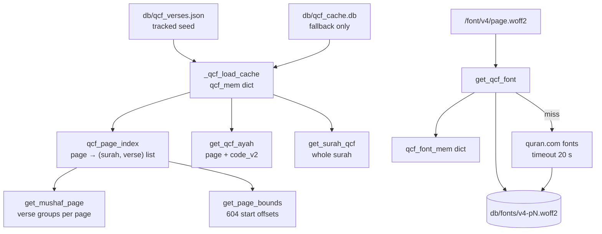

- `_qcf_load_cache()` loads the seed once into `qcf_mem`
  (`{(surah, verse): (page, code_v2)}`), then builds `qcf_page_index`
  (`{page: ((surah, verse), …)}`). A lock prevents a half-filled cache on the
  first concurrent requests. If the seed is missing, it falls back to the
  SQLite cache.
- `get_qcf_ayah()` can still fetch from
  `api.quran.com/api/v4/verses/by_key/{s}:{v}?fields=page_number&words=true&word_fields=code_v2`
  for an install without the seed; it has a 6 s timeout, a 15 s cooldown and
  writes successes to `db/qcf_cache.db`.
- `peek_qcf_ayah()` **never touches the network**. The whole-surah carousel
  uses it so building Al-Baqarah (286 verses) cannot stall on 286 HTTP calls.
- `get_qcf_font(page)` reads `db/fonts/v4-p{page}.woff2`, else downloads once
  from quran.com and caches the bytes in memory. The route serves them
  immutably.

Page membership follows the V2 mushaf everywhere: `get_mushaf_page`,
`get_page_bounds`, the reading map, and `library.get_mushaf_page`'s grouping.

### 4.5 Verse payloads

There are two payload shapes and five consumers.

| Function | Shape | Consumer | Notes |
|---|---|---|---|
| `get_verse_pickle(s, v)` | `dict` unpickled from `db2/quran_metadata.db` | low level | One BLOB per verse, ~311 MB DB, Git LFS |
| `p_getSurahInfo(s, v)` | full dict + root definitions + AI HTML + tajweed + QCF | `/<surah>/`, section API | Applies `RootDefAdder`, `get_ayah_tajweed`, `get_qcf_ayah`, starts both warmers |
| `get_verse_details(s, v)` | deep copy of `_verse_details_cached` (`lru_cache` 24) | `/<surah>/`, `/api/v1/verse/<s>/<v>/<section>` | Copy so callers can mutate (`RootDefAdder` already ran) |
| `get_verse_core(s, v)` | 7 keys + `ayah_tajweed`, `qcf_page`, `ayah_codev2` | `/<surah>/<verse>`, `/api/v1/verse/<s>/<v>` | `VERSE_CORE_KEYS`; the page ships only this |
| `get_surah_core(s)` | `{surah, name, count, verses: (ar, tr, page, codev2), prev, next}` | `/api/v1/surah/<n>` | `lru_cache(4)`, ~200 KB for Al-Baqarah |

`p_getSurahInfo` builds:

```
surah_name, surah, verse, prev, next, ayah, translation,
wordforword, definitions, morph, en_kathir, bn_zakaria,
ayah_tajweed, qcf_page, ayah_codev2, ai_explanation
```

`RootDefAdder` (inside `library.py`) decorates the pickle's morphology with
`db/sarf.json` root definitions, normalises `/` in definitions, and reads the
AI explanation from `db/ai_context.db` (`verse_analysis.verse` is **0-based**,
so it applies `verse - 1`).

**Why core vs full**: the full payload carries morphology, word-by-word,
definitions and two tafsir bodies — tens of KB. The first page load ships only
the core, and the accordions (`ai`, `wfw`, `defs`, `morph`, `bn`, `en`) are
fetched on demand from `/api/v1/verse/<s>/<v>/<section>`, which renders the
same Jinja partials as the page. That keeps one source of truth for markup.

### 4.6 Surah-wide readers

| Function | Source | Caching | Used by |
|---|---|---|---|
| `get_full_arabic(surah)` | `_quran_text()` + `quran_stat` | `lru_cache(8)` | `/mushaf`, `/translation`, `get_mushaf_page` |
| `get_full_tranlation(surah)` | `_quran_translation()` | `lru_cache(8)` | `/translation`, `/mushaf`, `get_mushaf_page` |
| `get_full_en_tafsir(surah)` | `db/en_kathir.db` | none | `/tafsir/en` |
| `get_full_bn_tafsir(surah)` | `db/bn_zakaria.db` | none | `/tafsir/bn` |
| `get_surah_qcf(surah)` | `qcf_mem` | none | `/mushaf` |
| `get_surah_core(surah)` | Arabic + translation + QCF | `lru_cache(4)` | `/api/v1/surah/<n>` |

All return `(surah_name, ((verse_no, text), …))` except `get_surah_core`.
The two tafsir readers and `get_full_en_tafsir` re-read `quran_stat.json` with
`pandas.read_json` on every call instead of using the `quran_stat()` cache —
a known small inefficiency, harmless for a 9 KB file.

### 4.7 Mushaf page and printed line layout

`get_mushaf_page(page)` returns a page as surah groups:

```
{
  page, prev, next,
  groups: (
    {surah, name, start, bismillah,
     rows: ({surah, verse, surah_name, arabic, translation,
             qcf_page, codev2, start, bismillah}, …)},
    …
  ),
  surah_names, count
}
```

- Membership comes from `qcf_page_index` (V2 pages).
- A page can span up to three surahs; each group gets a banner and basmala
  only when it contains that surah's first verse (and surahs 1 and 9 never get
  a basmala row).
- Cached with `lru_cache(8)`; the heavy per-surah data comes from the cached
  `get_full_arabic` / `get_full_tranlation`.
- Prev/next wrap: page 1 → 604, page 604 → 1.

`get_mushaf_lines(page)` returns the **printed line layout** from
`db/mushaf_lines.json` (1.9 MB, tracked), generated from
[zonetecde/mushaf-layout](https://github.com/zonetecde/mushaf-layout) QPC2
pages:

```json
{"pages": {"604": [["h", 112], ["b"], ["x", [[112, 1, "glyphs", "plain text"], …]], …]}}
```

`h` = surah banner, `b` = basmala, `x` = text line whose segments are
`[surah, verse, glyphs, plain Uthmani text]`. `_mushaf_lines()` loads and
transforms it once under a lock; `_mushaf_fix_banners()` moves a surah banner
that upstream put at the **bottom of the previous page** to the top of the page
where the surah actually starts (18 cases). The plain fragment gets its
Arabic-Indic verse number wrapped in parentheses (`(٢٥٥)`) by `_AYAH_END`,
because the normal-font view has no ornate QCF ayah marker.

`get_mushaf_lines` is `lru_cache(16)` and returns typed dicts
(`header` / `basmala` / `text` with `endblock`), which
`templates/mushaf_page.html` renders.

### 4.8 Overviews

Two identical-shape tables, both generated offline and committed:

| Table | Key | Columns | Reader |
|---|---|---|---|
| `page_overviews` | `page` 1–604 | `context`, `summary`, `model`, `generated_at` | `get_page_overview(page)` |
| `surah_overviews` | `surah` 1–114 | same | `get_surah_overview(surah)` |

Both readers return `{'context', 'summary'}` or `None` when the row, the file
or a paragraph is missing; `None` simply hides the accordion. Both use
`lru_cache(128)` and a parameterised query. The surah overview is included by
`comprehensive.html` above the options block, so it appears on `/translation`,
`/mushaf`, `/tafsir/en` and `/tafsir/bn`; the page overview appears only on
`/page/<n>`.

### 4.9 Reading-map helpers

| Function | Result | Notes |
|---|---|---|
| `surah_starts()` | 114 ints | 0-based flat index of each surah's first verse; `lru_cache(1)` |
| `verse_index(s, v)` | 0–6235 | `surah_starts[s-1] + v - 1`; validates bounds |
| `get_page_bounds()` | 604 ints | Start offset of each page, derived from `qcf_page_index`; returns `()` unless the total is exactly 6,236 |
| `get_ayah_themes()` | `{themes, verses}` | 12 themes + a 6,236-entry canonical-order id array; returns empty lists if `db/ayah_themes.db` is missing/incomplete |

The index page renders `window.AAYATUN_PAGE_BOUNDS` from `get_page_bounds()`,
so the map can place every verse without shipping a 6,236-entry table, and
`window.AAYATUN_THEMES` from `get_ayah_themes()`, so the popup's theme mode
needs no extra request and works offline. `verse_index` feeds `<meta
name="aayatun-read-index">` on verse and page views.

### 4.10 Legacy and unused paths

`getSurahInfo`, `get_morph`, `get_word_for_word_meaning`,
`get_word_definions`, `get_related_meanings`, `get_combined_df` read
`db/corpus.db`, `db/words.db` and `db/all_word_def.json` — **none of which exist
in the repo**. They are kept for reference but are unreachable from the live
routes: verse pages use `p_getSurahInfo()` (pickle-based) and the pickle already
contains the morphology and definitions. Do not wire them back in without
restoring those databases.

`db/search.db` (gitignored, ~125 MB) is built by `build_search.py` from local
DBs. Arabic is indexed in normalized form (diacritics stripped, alif/hamza/ya/
ta-marbuta unified) and rendered from the original Uthmani text; all columns
are stored normalized for matching with raw text as `UNINDEXED` display
columns. The `docs_trgm` trigram table (substring/root-search fallback) is
skipped automatically on hosts whose SQLite lacks the trigram tokenizer
(needs SQLite >= 3.34, e.g. PythonAnywhere); keyword search is otherwise
unchanged, only the substring fallback is lost there. Ranking is BM25 with
per-column weights emitted as OR'ed
column-filtered clauses (plain unfiltered FTS5 matches flatten the weights).
Multi-word queries run an all-tokens pass first and merge those rows in front
of the OR pass (bm25 orders within each tier), so complete matches always
outrank partial matches; a trailing `*` acts as a prefix wildcard.
The `db3/` Whoosh index and the `pd_backup.json` path are gone.

### 4.11 In-process caches

| Object | Size | Purpose |
|---|---|---|
| `quran_stat()` | 1 | Surah names/counts DataFrame |
| `_text_mem` | 2 dicts | Arabic + English text tables (~1.2 MB each) |
| `tajweed_mem` | all cached rows | Markup strings |
| `_fetch_tajweed_ayah` | 6,236 | Permanent per-verse fetch cache |
| `qcf_mem` | 6,236 | `(page, code_v2)` |
| `qcf_page_index` | 604 | Page → verses |
| `qcf_font_mem` | per page used | Font bytes |
| `_mushaf_lines_mem` | 604 pages | Parsed line layout |
| `_surah_warmed` / `_tajweed_warmed` | sets | Duplicate-warmer guards |
| `get_verse_core` | — | Not cached; cheap dict slices |
| `_verse_details_cached` | 24 | Full payload, deep-copied per call |
| `get_full_arabic` / `get_full_tranlation` | 8 each | Surah text |
| `get_full_tranlation` | 8 | Translation |
| `get_mushaf_page` | 8 | Page groups |
| `get_mushaf_lines` | 16 | Typed lines |
| `get_page_overview` / `get_surah_overview` | 128 each | AI overview rows |
| `get_surah_core` | 4 | Carousel payload |
| `_surah_payload` (app.py) | 8 | Gzipped JSON bytes |

The mutating caches use `threading.Lock` (text tables, QCF load, mushaf JSON)
because Flask's dev server and production workers handle requests in threads.

---

## 5. Data stores

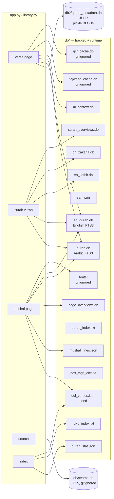

### 5.1 `db/` — the main data directory

Names are misleading; read this table, not the filenames.

| File | Size | Shape | Tracked? | Purpose |
|---|---|---|---|---|
| `quran.db` | 2.6 MB | FTS3 `verses(sura, ayah, text)` | yes | Plain Uthmani Arabic |
| `en_quran.db` | 2.0 MB | FTS3 `verses(sura, ayah, text)` | yes | English translation |
| `en_kathir.db` | 12.7 MB | `tafsir_kathir(surah, ayah, tafsir_text)` | yes | Ibn Kathir English tafsir |
| `bn_zakaria.db` | 20.6 MB | `verses(sura, ayah, text)` | yes | Abu Bakr Zakaria Bangla tafsir |
| `ai_context.db` | 31.9 MB | `verse_analysis(surah, verse 0-based, content)` | yes | AI word/verse analysis; `content` is a Python-literal dict evaluated with `eval` |
| `quran_stat.json` | 9.5 KB | DataFrame | yes | `Surah` names + `Verses` counts |
| `sarf.json` | 1.4 MB | DataFrame | yes | Root → baab/form/description |
| `qcf_verses.json` | 434 KB | `{"verses": [[s,v,page,code_v2], …]}` | yes | QCF text + V2 page membership |
| `mushaf_lines.json` | 2.0 MB | `{"pages": {"N": [lines]}}` | yes | Printed line layout, 604 pages |
| `page_overviews.db` | 840 KB | `page_overviews(page, context, summary, model, generated_at)` | yes | AI page orientation |
| `surah_overviews.db` | 180 KB | `surah_overviews(surah, context, summary, model, generated_at)` | yes | AI surah orientation |
| `ayah_themes.db` | ~180 KB | `themes(id, name, color)` + `verse_themes(surah, verse, theme_id)` | yes | 12 one-word themes, one per ayah |
| `quran_index.txt` | 61 KB | Python literal list of `(surah, verse)` | yes | Flat mushaf order (legacy path + search) |
| `ruku_index.txt` | 5.4 KB | Python literal list of `(surah, verse)` | yes | Ruku starts; random **Surprise me!** |
| `pos_tags_dict.txt` | 1.3 KB | Python literal dict | yes | POS tag → description |
| `tajweed_cache.db` | 1.6 MB | `taj(sura, ayah, markup)` | **no** | Runtime tajweed cache |
| `qcf_cache.db` | 274 KB | `qcf(sura, ayah, page, codev2)` | **no** | Seed fallback / network cache |
| `fonts/v4-pN.woff2` | — | binary | **no** | Downloaded QCF page fonts |
| `.secret_key` | 64 B | hex | **no** | Flask session key fallback |

The `.txt` indexes are **Python literals**, not JSON; they are read with
`ast.literal_eval` (`ruku_index.txt`) or `eval` (`quran_index.txt`,
`pos_tags_dict.txt`). Keep them valid Python when regenerating.

### 5.2 `db2/` — verse metadata (Git LFS)

`db2/quran_metadata.db` (~311 MB) holds `verses(surah, verse, data)` where
`data` is a pickled Python dict. `get_verse_pickle` selects one row and
unpickles it. This is the backbone of every verse page: `ayah`, `translation`,
`prev`, `next`, word-for-word, definitions, morphology, both tafsirs and the AI
explanation. Without `git lfs pull`, verse pages fail.

### 5.3 `db/search.db` — FTS5 search index

`build_search.py` (run from the repo root; also invoked automatically once by
`searchtool._ensure_db()` if the file is missing) reads `db/quran.db`,
`db/en_quran.db`, `db/en_kathir.db`, `db/bn_zakaria.db`, `db/ai_context.db`
(flattened `verse_context` + word meanings) and `db/quran_stat.json`, strips
HTML, normalizes (via `searchnorm.normalize`) and writes two FTS5 tables:
`docs` (all columns + raw display columns as `UNINDEXED`, BM25 weights
ar/en 10, AI 1.5, tafsirs 2, surah name 3) and, when the host's SQLite
supports it (>= 3.34), `docs_trgm` (trigram over the
Arabic and English text for substring/root search fallback). Also writes
`db/search_vocab.pkl` (token → frequency, ~30 k entries) which powers
edit-distance "did you mean" suggestions via a BK-tree built lazily on the
zero-hit path. `db/search_synonyms.json` holds curated synonym groups
(English transliteration/Quranic terms + a small Arabic set); a glossary hit
ORs the whole group into the query, which is why translations still outrank
AI passages for common words. Highlighting wraps the original (diacritized)
text using a normalized→original index map, escaping via `_render` in
`searchnorm.py`. Bengali has no stemming; it matches on exact tokens and
trigram substrings (where the host's SQLite provides them).

---

## 6. Template layer

### 6.1 Inheritance

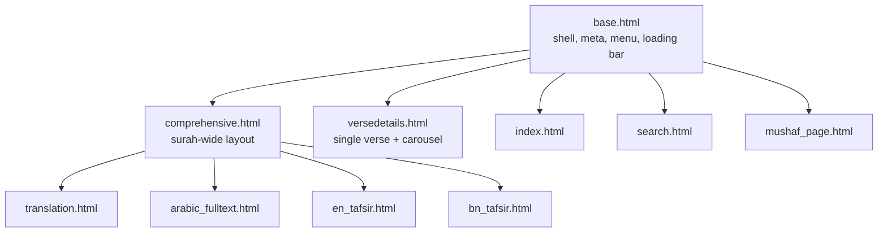

### 6.2 `base.html` — the shell

Responsible for:

- Early head script: applies `html.dark-theme` from
  `localStorage['darktheme']` before first paint and restores the loading bar
  from `sessionStorage['aayatun_loading']`.
- Meta: `theme-color`, viewport, manifest, iOS meta tags, default
  description/OG/Twitter tags (`og:site_name/type/title/description/url/image`,
  `twitter:card=summary`; `twitter:*` reuses `self.og_*()`).
- CSS: Fomantic CDN, `static/css/style.css`, Google Fonts
  (Open Sans, Merriweather, Amiri, Scheherazade, Lora, Baloo Da 2).
- Scripts: deferred jQuery + Fomantic, `recent.js`, `share.js`; pages add their
  own via ``.
- The menu bar (``), search modal, loading bar and content
  container.
- Loading-bar controller (`showLoading`/`hideLoading`) outside jQuery and
  `DOMContentLoaded`; it hooks link clicks in the capture phase and form
  submits, exposes `AayatunNav.go(url[, replace])` for programmatic
  navigations (also showing the parent page's bar from the verse-modal
  iframe), and honours `data-loading`/`data-navigate` buttons, so mobile
  browsers paint the bar before navigation. Inline `onclick` handlers that
  assign `location.href`/`replace`/`assign` are caught as a fallback.
- Blocks: `title`, `meta_description`, `og_type`, `og_title`, `og_description`,
  `js`, `head_extra`, `start`, `menu`, `content`, `content2`, `content3`,
  `end_`, `scriptcontent`.

### 6.3 `comprehensive.html` — surah-wide pages

Used by `/translation`, `/mushaf`, `/tafsir/en`, `/tafsir/bn`.

- Menu: prev/next surah arrows with `url_for` targets supplied by each child.
- Includes `partials/_verse_modal.html` (the shared verse iframe modal).
- Includes `partials/_surah_overview.html` above the options block.
- Provides `` (toggles) and ``.
  The Arabic view supplies a `<template>` containing a real two-cell row;
  `drawCallback` clones it to the start of page one's `<tbody>` after every
  DataTables draw. This puts the basmala under the search controls with the
  verses without making it sortable or part of pagination.
- Renders one repeated block per verse with a `font_config` block that each
  child overrides (Scheherazade 225 % for Arabic, Lora 100 % for translation,
  Baloo Da 2 for Bangla).
- DataTables keeps pagination/state saving on (`paging`, `stateSave`,
  `lengthChange` true); the `` blocks only choose the mushaf
  markup (`mushaf-ayah`, hidden QCF span, extra translation).
- Share macro receives `share_card` and `share_more`.

### 6.4 `versedetails.html` — the verse page

The most scripted template.

- Head: `qcf-font.js`; a parse-time tajweed init that adds
  `html.tajweed-pending` and hides the plain `h1` until colours are applied.
- Menu: prev/next verse arrows (`onclick="navigateVerse(...)"`), surah:verse
  link, home link.
- `#pagecontent` with two viewports/tracks:
  - `#ayah-viewport` / `#ayah-track`: three panes; the centre pane holds
    `#ayah` (only one `id="ayah"` exists at a time), neighbours are
    `div.ayah-text`.
  - `#translation-viewport` / `#translation-track`: the same three-pane model.
- Hidden sources: `#ayah-codev2` (`data-page`, `data-text`),
  `#ayah-markup-src`, `#ayah-plain-src`.
- Tajweed legend, credits (King Fahd Complex, quran.com, Al Quran Cloud).
- Audio box (everyayah.com MP3, `preload="none"`), loop/tajweed/close
  controls.
- Control row: More, share, **Mushaf** jump (removed inside an iframe),
  tajweed, play.
- `#verse-sections` accordion with `data-section` and `data-loaded` for
  `ai`, `wfw`, `defs`, `morph`, `bn`, `en`; `grammar` is static and links to
  Corpus Quran.
- `verse-nav.js` is loaded with `defer`; the page ships the core payload only.
- The API token is in `<meta name="aayatun-api-token">`.

### 6.5 `mushaf_page.html` — `/page/<n>`

Extends `base.html` directly (not `comprehensive.html`) and contains two views
over the same page:

1. **Table view** — `#mushaf-page-table`, one row per verse grouped by surah,
   with `mushaf-ayah` spans holding both `.mushaf-plain` and `.mushaf-qcf`.
2. **Printed layout view** — `#mushaf-layout`, lines from
   `library.get_mushaf_lines`, with clickable verse segments and a credit line.

Both start with `partials/_mushaf_zoom.html`. The page-overview accordion sits
above the controls (`partials/_ai_notice.html` + `context`/`summary`). The
layout view is the default and is persisted in
`localStorage['aayatun_mushaf_layout_v1']`; a head script hides the table
before first paint so it never flashes. Tajweed is on by default here.

The inline script:

- fits printed lines by measuring at 100 px and scaling the widest line,
  re-fitting on resize, tajweed toggle and zoom change;
- caps pages 1–2 at a smaller size because their printed lines are short;
- justifies every line except `endblock` lines;
- paints `.mushaf-seg-active` on every segment of a verse (a verse split
  across lines shares one `data-surah`/`data-verse`);
- implements swipe navigation (pointer drag, 25 %/velocity commit, 1:1
  follow-the-finger, neighbour prefetch), keyboard arrows, and the
  `?v=surah:verse` jump highlight;
- hides the layout until the active face (QCF or plain) is painted and fitted.

### 6.6 `index.html`

- Hero, surah picker (`#surah` options are also the map's surah table), Go.
- **Surprise me!** (`surpriseTarget()`: 50 % random page, otherwise the
  server-picked ruku verse).
- **Quran Exploration Map** button beside it in `.home-actions-row`.
- **Recently Read** chips rendered by `recent.js`.
- Map modal (`#reading-map-modal`), clear-history confirmation
  (`#clear-history-modal`), iOS install banner.
- Footer: repo link on the “Aayatun v2.0” label, **More Apps** pointing popup
  (`#more-apps-popup`, a Fomantic `on: 'click'` popup anchored to
  `#more-apps-btn`, not a modal) listing Prayer Time and Counter.
- `window.AAYATUN_PAGE_BOUNDS` is injected in the head.
- Registers the service worker (`static/service-worker.js`).
- Uses **CRLF** line endings; edit with care to keep diffs minimal.

### 6.7 `search.html`

Renders `results` (list of dicts from `searchtool`), `suggestions` (list of
correction tokens), `corrected` (auto-correction banner text when a zero-hit
query was re-run against edited tokens), `query`, `limit_label`,
`filter_value`. Each result row carries `chips` (match locations:
verse / translation / tafsir I.K. / tafsir Z. / AI explanation) and
per-column snippets with the matched text wrapped in `<span class="match">`.
Includes the shared verse modal so a result can open the verse in place.

### 6.8 Partials

| Partial | Purpose |
|---|---|
| `_verse_modal.html` | Shared Fomantic modal with an iframe; used on `/search` and the mushaf views. Reveals on iframe `DOMContentLoaded` (polled 40 ms), pauses/rewinds audio on hide. |
| `_ai_notice.html` | Shared AI warning banner (page/surah overview, verse AI section). |
| `_surah_overview.html` | Surah Overview accordion (`context`, `summary`), included by `comprehensive.html`. |
| `_mushaf_zoom.html` | −/+ zoom stepper with `NNN%` readout, used by both mushaf views. |
| `_share_macros.html` | Renders the share button with `data-share-*` payload (including `data-share-card` JSON and `data-share-more`). |
| `_section_ai.html` | AI explanation section. |
| `_section_wfw.html` | Word-for-word section. |
| `_section_defs.html` | Definitions section. |
| `_section_morph.html` | Morphology section (root, lemma, verb table, annotations). |
| `_section_bn.html` / `_section_en.html` | Bangla / English tafsir sections. |

### 6.9 SEO and share metadata

- `base.html` owns the defaults. Reading templates override
  `og_title`/`og_description`; the verse page additionally sets
  `og_type=article` and `meta_description`.
- The verse page's OG image is the site icon, not a generated card (share cards
  are client-drawn PNGs handed to the Web Share API).
- `mushaf_page.html` uses the page overview's summary as its description when
  present.

---

## 7. Client-side JavaScript

| Module | Loaded by | Responsibility |
|---|---|---|
| `script.js` | `base.html` (blocking, before content) | Dark theme, page-type constants, menu/search modal helpers |
| `recent.js` | `base.html` (deferred, every page) | Recently Read list + reading-map bitsets |
| `share.js` | `base.html` (deferred, every page) | Share text + canvas cards + Web Share/clipboard |
| `qcf-font.js` | verse page, mushaf page | QCF font loading, palette, toggle persistence |
| `verse-nav.js` | verse page (deferred) | Carousel, surah payload LRU, section fetch, offline verse cache |
| `mushaf-zoom.js` | mushaf views | Zoom steps, `--mushaf-zoom`, refit callback |
| `reading-map.js` | index only | 6,236-square map, selection, scrollbar, share data |
| `swiped-events.min.js` | legacy/utility | Synthetic swipe events (vendored) |

### 7.1 `qcf-font.js`

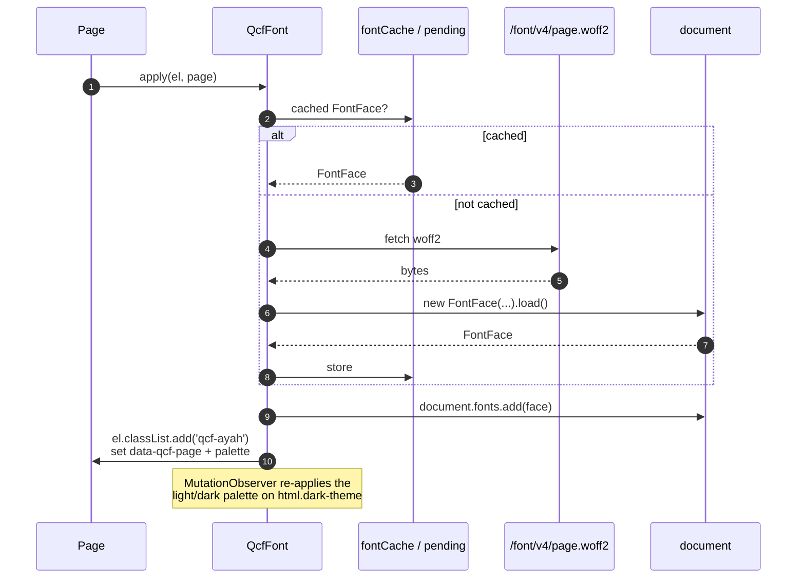

Public API: `get`, `setOn`, `isOn`, `supports`, `load`, `isLoaded`, `apply`,
`clear`. The on/off choice is `localStorage['ayahTajweedOn']` and is shared by
all three surfaces. Fonts are per page, so a page only downloads the font(s) it
shows; neighbours are prefetched by `verse-nav.js`/the mushaf page.

### 7.2 `verse-nav.js` — the carousel

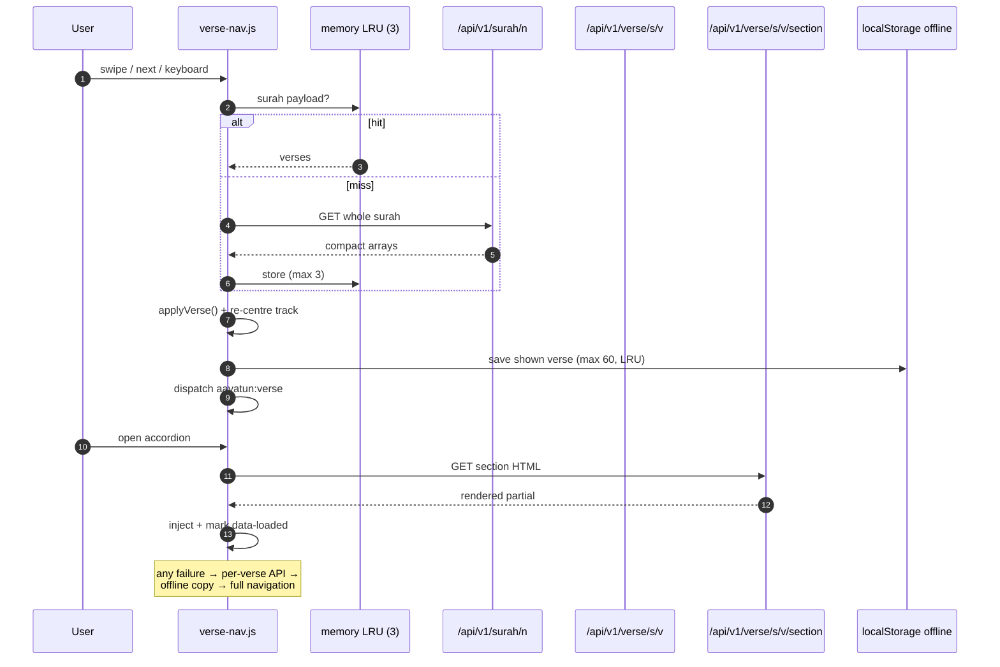

Details:

- **Memory-only** surah LRU (3 entries). No sessionStorage, IndexedDB or
  service-worker caching of payloads.
- Two 3-pane tracks (Arabic + translation) with pointer-drag axis detection,
  25 %/velocity commit, follow-the-finger, then `applyVerse()` and an instant
  re-centre.
- The only `id="ayah"` lives on the centre pane; neighbours are
  `div.ayah-text`.
- Accordion sections are fetched lazily and only once (`data-loaded`).
- Every verse actually shown is written to
  `localStorage['aayatun_verse_offline_v1']` (max 60, LRU by timestamp) with
  Arabic, translation, QCF page/text, prev/next. Offline, `dataFor`/`loadVerse`
  read that; a failed navigation with nothing cached falls to
  `static/offline.html`.
- `applyVerse()` dispatches `aayatun:verse`, which `recent.js` uses to update
  the map (and the verse chip, except inside the modal iframe).
- The module exits early on pages without `#pagecontent` or a token meta.

### 7.3 `mushaf-zoom.js`

Four steps (100/125/150/175 %) stored in
`localStorage['aayatun_mushaf_zoom_v1']`, shared by `/page/<n>` and
`/mushaf/<surah>`. It writes `--mushaf-zoom`, which `style.css` multiplies into
`.mushaf-ayah` (225 % plain, 165 % QCF), so tables simply reflow. The printed
layout is px-sized, so it refits through `MushafZoom.onChange`.

### 7.4 `recent.js` — Recently Read + reading map

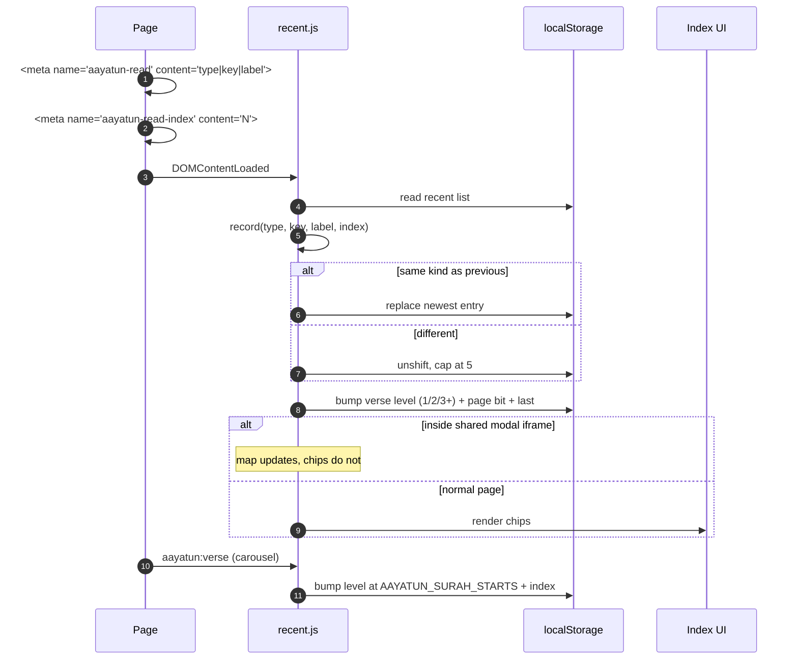

- `localStorage['aayatun_recent_reads_v1']`: max 5, newest first, runs of the
  same kind collapse (42 → 43 → 44 leaves only “Page 44”).
- `localStorage['aayatun_read_map_v2']`: two bits per verse
  (0/1/2/3 = never/1×/2×/3+×), 604 page bits and `last`. A legacy
  `aayatun_read_map_v1` bitset is migrated as “opened once”.
- A verse page opened in the shared modal marks the map (the page really is
  open) but leaves the chips behind the modal unchanged. `record()` updates
  the map *before* its `window.self !== window.top` return.
- `clearAll()` removes both keys; the map modal's **Clear Visit History** button calls it and
  then `AayatunReadingMap.refresh()`.
- Pages without the meta (home, search, translation, tafsir, prayer-time)
  never record.

### 7.5 `reading-map.js` — Quran Exploration Map

- 6,236 squares in canonical mushaf order, GitHub-contribution style: 10 px
  squares, 3 px gap, 2 px radius, `grid-auto-flow: column`, one blank
  `.rg-break` cell before each surah (113 breaks).
- States: page-view tint and three deeper greens (`0`–`4`); a deeper level
  always beats the tint.
- No network: data comes from `recent.js` bitsets; the page mapping is
  `window.AAYATUN_PAGE_BOUNDS`, surah names/counts come from `#surah`.
- `layoutMap()` derives the row count from the space under the map, clamps it
  to `[126px, 70 % vh]` and at least 12 rows, then sets
  `grid-template-rows` and the frame height. Re-measured after the modal
  transition and on resize.
- One-way scroll: the grid scrolls horizontally only; a custom thumb
  (`.reading-map-scrollbar`, `role="scrollbar"`) replaces the hidden native
  scrollbar, with track click, Home/End/Arrows.
- The stats card stacks its two progress rings **vertically** so the lead
  card gets more width; the 900 px grid is `1.45fr / 1.1fr / 0.9fr`.
- A circular **zoom stepper** at the right end of the legend row (− / + /
  NNN%, 100–200 % in 25 % steps) scales every square through `--map-zoom`;
  the rows-per-height, the pitch and the axis ticks all refit, and the step
  is remembered in `localStorage['aayatun_map_zoom_v1']`.
- Clicking a square selects it (readout + border stay on it; hover only
  previews). Clicking **anywhere outside the grid** clears the selection and
  restores the hint.
- A **Themes** switch in the legend row (shown only when `window.AAYATUN_THEMES`
  is present) flips the map into theme mode: the cell fill carries the theme
  and every read verse (state ≥ 1) gets a white tick; the page-visit legend is
  replaced by a simplified one (`Unread` + `Read` with a ticked swatch) with a
  context label sitting between the switch and the legend (`Page Read
  Statistics:` in reading mode, `Verse Read Statistics:` in theme mode). The
  selectable 12-theme legend is sorted by frequency; tapping one highlights it
  temporarily (every other theme's cells drop to low opacity) until tapped
  again or theme mode is switched off, or the map is closed. The switch shows
  the site loading bar and fades the grid through the swap; motion respects
  `prefers-reduced-motion`. The selected-verse readout shows the verse's theme
  (coloured chip + name) ahead of `Surah n:v — state`. The switch position is
  stored in `localStorage['aayatun_read_map_themes_v1']`. A small line at the
  bottom of the popup reads "Verse themes: AI-assisted (Aayatun)". The share
  card and poster remain reading-only.
- Suggestion: first unread white verse after `last` (wrapping), then the page
  tint, then any opened verse.
- The share card is drawn by `share.js` from the same state array; only the
  shared image is subsampled (6,236 verses → 84×42 cells), never the popup.
- The poster order is title → progress rings → bitmap → dated “Every square
  is one verse…” message → “What the colours mean” key → site band.

### 7.6 `share.js`

Two outputs from one module: **text** and an optional **PNG card**.

**Text** — the URL lives inside the text (never a separate `url` field) so it
cannot be dropped or duplicated:

| View | Format |
|---|---|
| Verse | `S:V`, blank line, translation, `Read on Aayatun: URL`, `#aayatun` |
| Surah | `Surah Name (N) — <view label> on Aayatun.` + URL + `#aayatun` |
| Page | `Mushaf page N — range` + `Read on Aayatun: URL` + `#aayatun` |

Order: `navigator.share` (with the card when one exists) → clipboard +
checkmark → `window.prompt`. There is no download fallback.

**Card** — drawn on a canvas, never a screenshot:

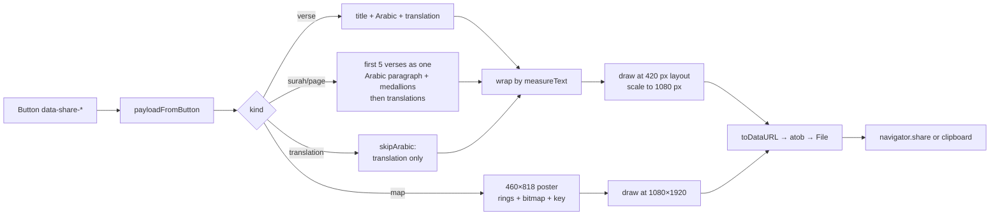

- Reading cards are laid out at **420 px** and rendered at **1080 px** wide;
  the map poster is a **460×818** layout rendered at **1080×1920**.
- Arabic uses `state.ayah` for the single-verse card and the server's plain
  Uthmani rows (never `code_v2`) for multi-verse cards, so a card is never
  coloured.
- End-of-ayah medallion: `U+06DD` + Arabic-Indic digits. Medallions are
  word-tokens; a medallion may overhang the previous line but never starts one.
- Title in Merriweather (`#4183C4`, `#9CC4FF` dark); subtitle carries the view
  or the page's verse range.
- The multi-verse card shrinks both faces (31/15 → 21/12 px) until the body
  fits 1320 CSS px and appends `…` when verses were dropped.
- Drawing is synchronous (`toDataURL` → `atob` → `File`) so Safari keeps the
  user activation.
- `document.fonts.load()` warms Merriweather/Scheherazade/Open Sans with an
  Arabic sample at startup, because Google Fonts ships Scheherazade as
  unicode-range subsets (a bare `load()` fetched only Latin and left tofu on
  `/translation`).
- The map poster is drawn and encoded once while its modal opens
  (`warmMapShare`, keyed by counts + position hash), so the tap only hands over
  a finished file.
- Map poster copy: the dated line “Every square is one verse of the Quran. This
  is how far I have explored as of <date>.”, then a **“What the colours
  mean”** heading over five bullet rows (colour square + full sentence: not
  opened yet / on a page you have opened / verse opened once, twice, 3 or more
  times), and a closing “Track your own reading at aayatun.com · #aayatun”
  above the band. The share text mirrors it and invites the reader to track
  their own journey.

### 7.7 `script.js`

Small globals: dark-theme helpers (`set_dark_theme`, `is_dark_theme`), page-type
constants, menu/search-modal wiring. It is loaded synchronously before the
content so the theme and menu work even if later CDN scripts fail.

---

## 8. Service worker, PWA and offline

`static/service-worker.js` is served at `/service-worker.js` (root scope) and
registered from `index.html` and both standalone pages (`/prayer-time`,
`/daily-counter`). `CACHE_NAME` is currently **`aayatun-v67`**; bump it
whenever the precache list or caching logic changes.

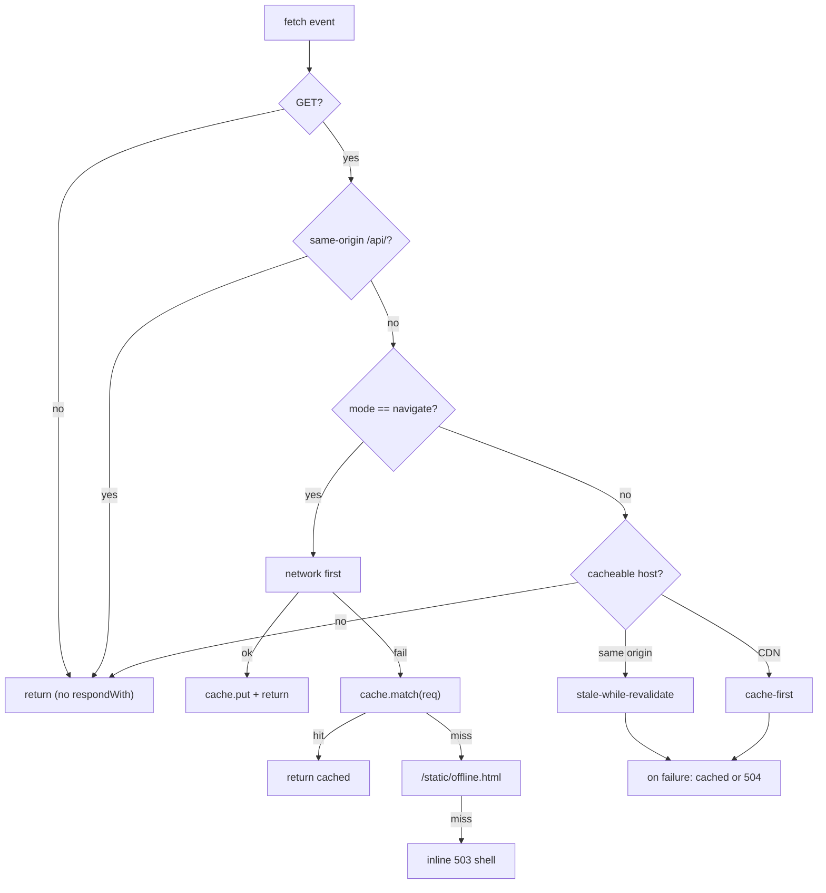

- **Precached shell**: `/`, `/prayer-time`, `/daily-counter`,
  `/static/offline.html`, the app JS modules (`script`, `recent`, `share`,
  `reading-map`, `verse-nav`, `qcf-font`, `mushaf-zoom`, `install`),
  `style.css`, the three manifests (`manifest.json`, `manifest-prayer.json`,
  `manifest-counter.json`) and the icons, plus the Material Symbols stylesheet
  Prayer Time uses for its sunrise/sunset pills. Install then fetches that
  stylesheet, pulls every `url(https:…)` glyph file out of it and caches those
  too, so the icons survive offline.
- **Navigations**: network first, cache fallback, then `offline.html`, then an
  inline 503. Every `respondWith` path resolves to a `Response`; a failed fetch
  with nothing cached used to resolve `undefined` and throw
  “Failed to convert value to 'Response'”.
- **`/api/*` is never cached** (session-bound JSON and HTML).
- Same-origin assets use stale-while-revalidate; CDN hosts
  (`cdn.jsdelivr.net`, Google Fonts) use cache-first.
- `activate` deletes every cache whose name is not `CACHE_NAME` and claims
  clients.

**PWA**

- `static/manifest.json` fixes `id`/`scope`/`start_url` to `/`, so the app must
  be installed from `https://www.aayatun.com` (the apex 301s there). An install
  from the apex stays in the in-app browser and must be removed and re-added.
- `static/manifest-prayer.json` and `static/manifest-counter.json` give each
  standalone tool its **own** `id`/`start_url` (`/prayer-time`,
  `/daily-counter`), so installing from that page opens that page. Both pages
  carry a `[data-install-app]` button driven by `static/js/install.js`: the
  real Chromium sheet when `beforeinstallprompt` fires, otherwise a dark help
  sheet with the manual Share → Add to Home Screen steps (iOS never fires the
  event). The button is hidden in standalone mode and in-app browsers.
- Chromium's `beforeinstallprompt` drives the Android/desktop banner; iOS never
  fires it, so `index.html` shows a separate **Install Aayatun** / **How?**
  banner (`#ios-install-modal`) only for iOS/iPadOS (`MacIntel` +
  `maxTouchPoints > 1`), never in standalone or an in-app browser. Dismissal is
  stored in `localStorage['aayatun_ios_install_dismissed_v1']`.

**Offline reading**

- `static/offline.html` renders the last saved verse when an uncached verse
  navigation fails offline.
- The mushaf page route sets `private, max-age=300` and prefetches neighbour
  pages (and their fonts) so a turn is a cache hit.
- Prayer Time keeps Aladhan calendar months in
  `localStorage['prayer-times-offline-v1']` (current + next month, keyed by
  place + `method`/`school`).

---

## 9. External services and failure policy

| Service | Used for | Transport | Failure behaviour |
|---|---|---|---|
| `api.alquran.cloud` | Tajweed rule markup | Server, `urllib`, 4 s timeout | 15 s cooldown; verse renders plain; cached successes still work |
| `api.quran.com` | QCF `code_v2` fallback | Server, 6 s timeout | 15 s cooldown; seed usually removes the need |
| `quran.com/fonts/…` | Per-page COLRv1 woff2 | Server, 20 s timeout on first use | `/font/v4/…` returns 404; QCF span stays hidden, plain text remains |
| `www.everyayah.com` | Recitation MP3 | Browser, `preload="none"` | Audio simply fails; page unaffected |
| `api.aladhan.com` | Prayer times | Browser (`prayer-time.html`) | Cached months still render; UI shows offline state |
| `cdn.jsdelivr.net` | jQuery, Fomantic | Browser, service-worker cached | SW cache serves the last copy |
| `fonts.googleapis.com/gstatic` | UI/Arabic fonts | Browser, SW cached | Fallback font families |

The rule throughout: **a remote failure degrades one feature, never the page.**
The Quran text, translations, tafsir, metadata, QCF seed and line layout are
local, so `/2/255`, `/page/42`, `/translation/2` and `/mushaf/2` render with no
outbound network at all.

---

## 10. Caching model

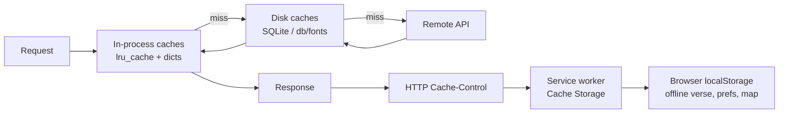

| Tier | Scope | What | Lifetime |
|---|---|---|---|
| Python dicts | Process | text tables, `tajweed_mem`, `qcf_mem`, `qcf_font_mem`, `_mushaf_lines_mem` | Until restart |
| `lru_cache` | Process | see [§4.11](#411-in-process-caches) | Eviction by size |
| SQLite | Host | `tajweed_cache.db`, `qcf_cache.db` | Permanent |
| Disk files | Host | `db/fonts/v4-pN.woff2` | Permanent |
| HTTP | Browser/proxy | `private_page` (pages with token), `no-store` (API), `private, max-age=300` (mushaf pages), `immutable` (fonts) | Per header |
| Service worker | Browser | app shell, same-origin assets, CDN assets | `aayatun-v67` until bumped |
| `localStorage` | Browser | prefs, offline verse, recent reads, map | Until cleared |

**localStorage / sessionStorage keys**

| Key | Written by | Purpose |
|---|---|---|
| `darktheme` | `script.js` / `base.html` | Theme |
| `ayahTajweedOn` | `qcf-font.js` | Coloured QCF face on/off |
| `aayatun_mushaf_layout_v1` | `mushaf_page.html` | Printed layout vs table (only `0` means table) |
| `aayatun_mushaf_translation_v1` | `mushaf_page.html` | Translation toggle |
| `aayatun_mushaf_zoom_v1` | `mushaf-zoom.js` | Zoom step index |
| `aayatun_recent_reads_v1` | `recent.js` | Recently Read (max 5) |
| `aayatun_read_map_v2` | `recent.js` | Per-verse levels + page bits + `last` |
| `aayatun_read_map_v1` | old build | Migrated once into v2 |
| `aayatun_verse_offline_v1` | `verse-nav.js` | Last 60 shown verses |
| `aayatun_ios_install_dismissed_v1` | `index.html` | iOS banner dismissal |
| `prayer-times-offline-v1` | `prayer-time.html` | Aladhan month cache |
| `aayatun_loading` (session) | `base.html` | Loading bar across navigation |

---

## 11. Security and privacy

- **Nav API token.** `api_token()` mints a per-session token
  (`secrets.token_urlsafe(32)`) and stores it in the signed Flask session. The
  verse page renders it as `<meta name="aayatun-api-token">`; fetch calls send
  `X-Aayatun-Token`. `require_api_token()` compares with
  `hmac.compare_digest` and also checks `same_site_request()`
  (`Sec-Fetch-Site` ∈ {same-origin, same-site}, and `Origin`/`Referer` host
  equal to the request host). Cross-origin reads are additionally blocked
  because no CORS headers are sent. This stops hotlinking and third-party
  embedding, not a determined local attacker — a browser token cannot be
  secret.
- **Cache isolation.** Any page that embeds the token is sent with
  `private, max-age=0, must-revalidate`, so a shared cache cannot hand one
  session's token to another. API responses are `private, no-store`.
- **Sessions.** `HTTPONLY`, `SAMESITE=Lax`, and `Secure` when
  `AAYATUN_HTTPS=1`. The key comes from `AAYATUN_SECRET_KEY`, else
  `db/.secret_key` (mode 0600, created atomically), else an ephemeral key.
- **SQL.** Existing queries interpolate integer route params with f-strings;
  new code uses bound parameters (overviews, `get_verse_pickle`, QCF/tajweed
  caches). Treat any new string input as unreviewed until parameterised.
- **No secrets in the repo.** Content generators keep API keys in a temporary
  environment file outside the repo and never write them to data files.
  `db/.secret_key` is gitignored.
- **Third-party content.** Tafsir/AI text is injected via `Markup` after the
  generator's own escaping (`utils.json_to_html` escapes fields); the AI
  explanation is `eval`'d from a trusted local DB, not from user input.

---

## 12. Offline content generation

Some data is too slow or too large to build at request time, so it is generated
offline and committed.


| Dataset | Generator | Rules |
|---|---|---|
| `db/qcf_verses.json` | one-off script from quran.com `by_page` endpoints | Page column corrected to **V2**; 6,236 rows; source of truth for QCF text/page membership |
| `db/mushaf_lines.json` | from `zonetecde/mushaf-layout` `v2/mushaf/QPC2/page-XXX.json` | Keep page membership in sync with `qcf_verses.json`; banners fixed at load |
| `db/page_overviews.db` | `/mnt/d/PROJECTS/aayatun_ai_content/generate_page_overviews.py` | Batched, resumable, Gemini/OpenAI; run from the app root; one row per page |
| `db/surah_overviews.db` | `…/generate_surah_overviews.py` | Batched by verse count, resumable; 70–110 word `context`/`summary`; 114 rows |
| `db/ayah_themes.db` | `generate_ayah_themes.py` | Batched by surah (40 ayahs per OpenAI call), resumable from a cached result file; a deterministic post-process fixes disconnected letters -> Revelation plus a short manual list; 6,236 rows |
| `db/search.db` + `db/search_vocab.pkl` | `build_search.py` | Run from the repo root after any source DB changes; outputs are gitignored; auto-built once by `searchtool` if missing |

Both overview generators store `model` and `generated_at`, never the API key.
The app only reads the resulting DBs; partial generation is safe because a
missing row hides its accordion.

---

## 13. Operations and change checklist

**Common commands**

```bash
flask --app app.py run --debug
python3 -c "import app; print(app.app.test_client().get('/2/255').status_code)"
git lfs pull
pip install -r requirements.txt
```

**Safe-to-delete runtime state**

- `db/fonts/`, `db/qcf_cache.db`, `db/tajweed_cache.db` — refetched on demand.
- `__pycache__/`.

**Change checklist**

- **Python**: tabs, not spaces. Route params are ints; use bound parameters for
  anything new.
- **`templates/index.html`**: CRLF line endings. A Python rewrite can silently
  convert it to LF and produce a 2,500-line diff.
- **Service worker**: bump `CACHE_NAME` whenever `CORE_ASSETS` or caching logic
  changes.
- **Search**: `/search` is POST-only. `db/search.db` is gitignored and built
  by `python3 build_search.py`; re-run it after any source DB changes. Deploy
  steps must include the build (or let the first search trigger it once).
- **Mushaf data**: `qcf_verses.json` and `mushaf_lines.json` must agree on page
  membership. Regenerate both together.
- **Overviews**: adding rows is additive; no code change is needed, the
  accordion appears automatically.
- **Share cards**: the `_share_macros.html` button is the only payload source;
  keep `data-share-card` single-quoted and `tojson`-escaped.

**Deployment shape**

- One or more Flask workers behind a WSGI server. Session affinity is not
  required if `AAYATUN_SECRET_KEY` is shared; the in-process caches are
  per-worker and warm lazily.
- Serve over HTTPS and set `AAYATUN_HTTPS=1` so the session cookie is
  `Secure`.
- `db2/quran_metadata.db` must be pulled through Git LFS on deploy; the app
  cannot synthesise verse metadata.

---

## Appendix A — Route → library → template matrix

| Route | Library entry points | Template |
|---|---|---|
| `/` | `get_page_bounds`, `verse_index` (indirect) | `index.html` |
| `/<s>/` | `get_verse_details`, `verse_index`, `surah_starts` | `versedetails.html` |
| `/<s>/<v>` | `get_verse_core`, `verse_index`, `surah_starts` | `versedetails.html` |
| `/translation/<s>` | `get_full_tranlation`, `get_full_arabic`, `get_surah_overview` | `translation.html` → `comprehensive.html` |
| `/mushaf/<s>` | `get_full_arabic`, `get_full_tranlation`, `get_surah_qcf`, `get_surah_overview` | `arabic_fulltext.html` → `comprehensive.html` |
| `/tafsir/en/<s>` | `get_full_en_tafsir`, `get_surah_overview` | `en_tafsir.html` → `comprehensive.html` |
| `/tafsir/bn/<s>` | `get_full_bn_tafsir`, `get_surah_overview` | `bn_tafsir.html` → `comprehensive.html` |
| `/page/<n>` | `get_mushaf_page`, `get_mushaf_lines`, `get_page_overview`, `verse_index` | `mushaf_page.html` |
| `/api/v1/verse/<s>/<v>` | `get_verse_core` | JSON |
| `/api/v1/surah/<n>` | `get_surah_core` (via `_surah_payload`) | JSON |
| `/api/v1/verse/<s>/<v>/<section>` | `get_verse_details` | `partials/_section_*.html` |
| `/font/v4/<n>.woff2` | `get_qcf_font` | binary |
| `/search` | `searchtool.index_search` | `search.html` |

## Appendix B — Key invariants

1. **Verse text comes from the local DB.** Tajweed and QCF add decoration; they
   never replace the text used in share cards, translations or the fallback.
2. **Page membership is V2.** `qcf_verses.json`, `mushaf_lines.json`, the QCF
   fonts and the reading map all agree on 604 V2 pages.
3. **The core payload is small.** Accordion sections are fetched on demand and
   rendered by the same Jinja partials as SSR.
4. **The carousel never waits on the network for text.** `peek_qcf_ayah` is
   local-only; a missing QCF entry is simply blank until the warmer fills it.
5. **Every network feature degrades to plain.** No page requires alquran.cloud
   or quran.com to render.
6. **The tokenised page is private.** Never remove `private_page` from
   `/<s>/<v>` or `/<s>/`; never cache `/api/*` in the service worker.
7. **User state lives in `localStorage` only.** No server-side accounts, no
   cookies beyond the session token, no analytics.
8. **Generated data is committed and offline.** Overviews, search and layout
   JSON are produced outside the request path and never regenerated at runtime.
