# Aayatun — Architecture and Operations Manual

**Document type:** Technical description and procedures  
**Audience:** Maintainers and new developers

Aayatun is a server-rendered Quran reader. The system uses Flask 2.3, Jinja2,
SQLite databases and JSON files. The front end uses CDN-hosted jQuery and
Fomantic UI. There is no build step. There is no bundler. There is no npm.
There is no test suite.

`app.py` holds all routes. `library.py` is the only layer that reads data.
`templates/` renders the HTML. `static/js/` adds the interactive parts
(swipe carousel, mushaf view, share cards, reading map).

This document describes the whole system. The sections are modular. Read
Section 1 for orientation. Then read the module you need.

**Reading order for a new contributor**

1. [System at a glance](#1-system-at-a-glance)
2. [Boot and request lifecycle](#2-module-app-boot-and-request-lifecycle)
3. [Routes](#3-module-app-route-map)
4. [library.py — the data layer](#4-module-librarypy-the-data-layer)
5. [Data stores](#5-module-data-stores)
6. [Templates](#6-module-templates)
7. [Client JavaScript](#7-module-client-javascript)
8. [Service worker, PWA and offline](#8-module-service-worker-pwa-and-offline)
9. [External services](#9-module-external-services-and-failure-policy)
10. [Caching model](#10-module-caching-model)
11. [Security and privacy](#11-module-security-and-privacy)
12. [Offline content generation](#12-module-offline-content-generation)
13. [Operations and checklists](#13-module-operations-and-checklists)

**Writing convention** — this document follows the rules of Simplified
Technical English (ASD-STE100):

- Use short sentences. Maximum 25 words per sentence.
- Use the active voice.
- Use one idea per sentence.
- Use the same name for the same part every time.
- Use “must” for a requirement. Use “can” for a possibility.
  Use “will” for a future event.
- Write instructions as commands.

---

## 1. System at a glance

### 1.1 Purpose

Aayatun lets a reader open any verse of the Quran. The reader can switch
between Arabic, English translation, Bangla translation, tafsir and the
printed mushaf layout. All reading views show a per-verse detail page,
a surah page, a printed mushaf page, a theme page and a reading-map page.

### 1.2 Design principles

- **SSR first.** Every reading view works without JavaScript. The page is
  complete HTML when the browser gets it. JavaScript makes navigation,
  toggles, sharing and the map interactive.
- **One data layer.** Routes never open a database directly. Every route
  calls `library.py`.
- **Local data is authoritative.** The Quran text, translations, tafsir,
  verse metadata and the mushaf line layout are in the repository. The
  network is used only for tajweed colouring and the per-page QCF fonts.
  Each network feature has a local cache and a safe fallback.
- **Prebuilt content.** The search index, the AI overviews, the verse themes
  and the mushaf line layout are built offline. They are committed to the
  repository. The app does not build them at request time.
- **Layered caching.** Python dicts and `lru_cache` → on-disk SQLite →
  HTTP caching → service worker → `localStorage`. See
  [Section 10](#10-module-caching-model).
- **Graceful degradation.** If a network call fails, one feature is lost.
  The page still renders. See [Section 9](#9-module-external-services-and-failure-policy).

### 1.3 System overview diagram

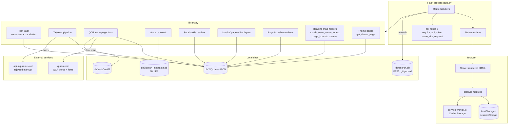

### 1.4 Page rendering diagram

This diagram shows how the server makes a page. The browser does the rest
after the request.

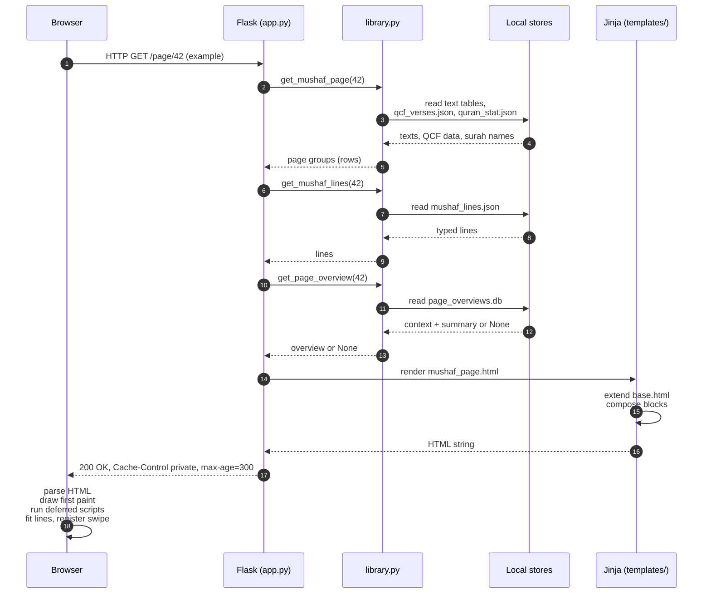

### 1.5 Data flow diagram

This diagram shows the data sources for each reading view.

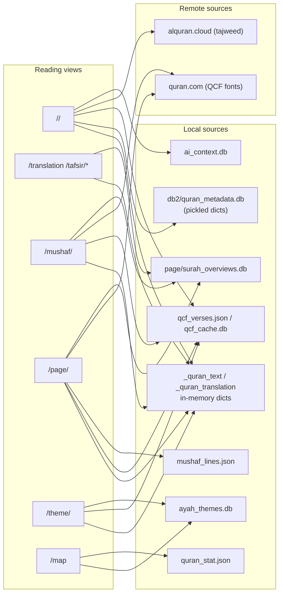

### 1.6 Repository layout

```
app.py              all routes
library.py          data access layer
searchtool.py       FTS5 query layer for /search
searchnorm.py       text normalization for search
build_search.py     offline search index builder
utils.py            shared helpers
templates/          Jinja templates (base + pages + partials)
static/css/         stylesheets
static/js/          client modules
static/images/      icons
db/                 live SQLite databases + JSON/text indexes
db2/                verse metadata (Git LFS)
db3/                legacy whoosh index (empty)
```

---

## 2. Module app — boot and request lifecycle

### 2.1 Boot sequence

`app.py` has no `__main__` block. Start the app with the Flask CLI:

```bash
flask --app app.py run --debug
```

At import time, `app.py` does the following:

| Step | Location | Action |
|---|---|---|
| 1 | imports | Reads `pandas`, `library`, `searchtool`, `gzip`, `hmac`, `secrets`. |
| 2 | module level | Calls `getRukuList()`. It parses `db/ruku_index.txt` with `ast.literal_eval`. The list is used by **Surprise me!** and by the index. |
| 3 | `library` import | Reads `db/pos_tags_dict.txt` with `eval()` into `pos_tags`. Builds the `roman_number` table. |
| 4 | `load_secret_key()` | Uses `AAYATUN_SECRET_KEY` if set. Otherwise it creates or reads `db/.secret_key` (mode 0600, atomic). Otherwise it uses an ephemeral key. |
| 5 | `app.config.update` | Sets `SESSION_COOKIE_HTTPONLY`, `SAMESITE=Lax`. Sets `Secure` cookie when `AAYATUN_HTTPS=1`. |
| 6 | first request | Text tables, the QCF seed, the mushaf JSON, the overviews and the fonts load lazily on first use. Each is guarded by a lock. Boot stays instant. |

The random ruku on the index is chosen per request. The response stays
cacheable. The choice between the map and a ruku verse for **Surprise me!**
is made in the browser, not on the server.

### 2.2 Request pipeline

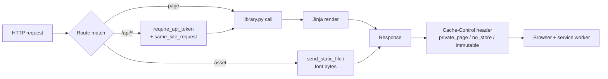

- Flask's default static route serves `/static/*`.
- `/service-worker.js` is served from `static/` so it sits at the origin root.
  A service worker controls only its scope. The root scope is required.
- The nav API is session-bound. A page that contains the token must never be
  stored by a shared cache. The app sends `private_page()`
  (`private, max-age=0, must-revalidate`). The API sends `no_store()`
  (`private, no-store`). The mushaf page sends `private, max-age=300`.
  Fonts send `public, max-age=31536000, immutable`.
- There are no blueprints. There is no middleware chain. The only error
  handling is Werkzeug's default `abort(404)` and `abort(403)`.

**Run and smoke test**

```bash
pip install -r requirements.txt
git lfs pull                     # db2/quran_metadata.db (~311 MB)
flask --app app.py run --debug   # run from the repo root; paths are relative
python3 -c "import app; print(app.app.test_client().get('/2/255').status_code)"
```

Python files use **tabs**. `db2` is Git LFS. If `db2` is missing, verse pages
raise `KeyError` in `get_verse_pickle`.

### 2.3 Rendering pipeline

The template render pipeline is the same for every page:

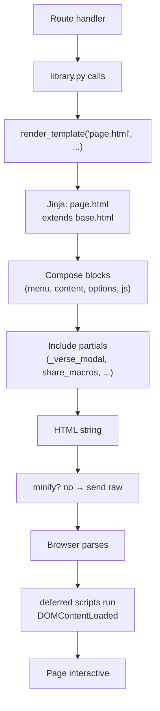
---

## 3. Module app — route map

All routes live in `app.py`. There are no blueprints.

| Method | Path | Handler | Renders / returns | Auth | Cache-Control |
|---|---|---|---|---|---|
| GET | `/` | `index` | `index.html` | — | default |
| GET | `/map` | `reading_map` | `map.html` | — | default |
| GET | `/<surah>/` | `details2` | `versedetails.html` (verse 1, full payload) | — | `private, max-age=0, must-revalidate` |
| GET | `/<surah>/<verse>` | `details` | `versedetails.html` (core payload) | — | `private, max-age=0, must-revalidate` |
| POST | `/search/` | `search` | `search.html` | — | default |
| GET | `/translation/<surah>` | `translation` | `translation.html` (comprehensive) | — | default |
| GET | `/tafsir/en/<surah>` | `en_tafsir` | `en_tafsir.html` | — | default |
| GET | `/tafsir/bn/<surah>` | `bn_tafsir` | `bn_tafsir.html` | — | default |
| GET | `/mushaf/<surah>` | `arabic_fulltext` | `arabic_fulltext.html` | — | default |
| GET | `/page/<n>` | `mushaf_page` | `mushaf_page.html` | — | `private, max-age=300` |
| GET | `/theme/<theme_id>` | `theme_page` | `theme.html` | — | `private, max-age=300` |
| GET | `/api/v1/verse/<s>/<v>` | `verse_api` | JSON core payload | token + same-site | `private, no-store` |
| GET | `/api/v1/surah/<n>` | `surah_api` | compact gzipped surah payload | — | `no-store`, `Vary: Accept-Encoding` |
| GET | `/api/v1/verse/<s>/<v>/<section>` | `verse_section_api` | HTML partial | token + same-site | `private, no-store` |
| GET | `/font/v4/<n>.woff2` | `qcf_font` | font bytes | — | `public, max-age=31536000, immutable` |
| GET | `/service-worker.js` | `sw` | `static/service-worker.js` | — | default |
| GET | `/prayer-time` | `prayer_time` | `prayer-time.html` verbatim | — | default |
| GET | `/daily-counter` | `daily_counter` | `daily-counter.html` verbatim | — | default |

Notes:

- The two standalone pages are served with `send_from_directory('.', …)`.
  They must stay at the repository root. They use no Jinja and no
  `base.html`. They register the service worker themselves.
- `/search` is **POST-only**. The form field is `query_str`. Optional
  fields are `target_field` (for example `en_tafsir:`; the allowed values
  are `ayah`, `translation`, `en_tafsir`, `bn_tafsir`, `ai`) and `limit`
  (`-1` means unlimited, default 25). A query matching `^\d+[:/.-]\d+$`
  (for example `2:255`) redirects straight to the verse.
- `/<surah>/` is kept for links that point at a surah. It renders verse 1
  with the full payload. `/<surah>/<verse>` ships the core payload only.
- All surah routes have `strict_slashes=False`. `/2/255` and `/2/255/` both
  resolve to the same page.
- `/page/<n>` validates `1 <= n <= 604`. `/theme/<id>` validates
  `0 <= id <= 11` and that the theme database is complete. Otherwise it
  aborts with 404.
- `/font/v4/<n>.woff2` validates `1 <= n <= 604`. The fonts come from the
  local `db/fonts/` cache when present, otherwise from quran.com, cached
  after the first download.
- `/map` passes the ayah-theme data to the page:
  `theme_data=lib.get_ayah_themes()`. The verse page pill links to
  `/theme/<id>?v=<surah>:<verse>`.

### 3.1 Cache-Control rules

| Case | Policy | Reason |
|---|---|---|
| `/<s>/<v>`, `/<s>/` | `private, max-age=0, must-revalidate` | The page contains the per-session API token |
| `/api/v1/*` | `private, no-store` | Per-session data, hot endpoints |
| `/api/v1/surah/<n>` | `no-store`, `Vary: Accept-Encoding` | Large payload; gzip handled by the route |
| `/page/<n>` | `private, max-age=300` | Static; swipe handler prefetches neighbours |
| `/theme/<id>` | `private, max-age=300` | Static taged verse list |
| `/font/v4/<n>.woff2` | `public, max-age=31536000, immutable` | Content-addressed fonts |
| `/search` | default | POST response, not cacheable meaningfully |
| everything else | default | No explicit header |

---

## 4. Module `library.py` — the data layer

`library.py` is about 1,300 lines. `app.py` and `searchtool.py` both import
it. The file has these sections, in order:

```
quran_stat, text tables, get_ayah
tajweed: rules, scan, align, render, cache, warmers
QCF: seed, cache, page index, fonts, warmers
tajweed_to_html / get_ayah_tajweed
per-verse translations, tafsir, morph, word meanings
legacy getSurahInfo
surah-wide readers
RootDefAdder
verse pickle / p_getSurahInfo
verse nav core + sections
surah QCF, mushaf page, mushaf lines
page/surah overviews
reading-map helpers (surah_starts, verse_index, page_bounds)
ayah themes + theme page
surah carousel payload
```

### 4.1 Layer view

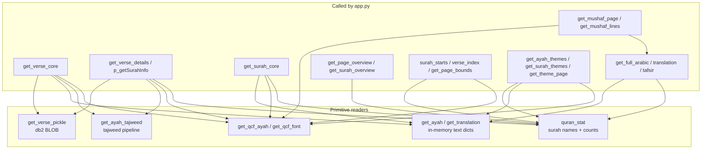

### 4.2 Text layer

`db/quran.db` and `db/en_quran.db` are FTS3 virtual tables. A query like
`where sura = ? and ayah = ?` scans the whole index. `_load_text_table()`
reads all 6,236 rows once into a Python dict `{(surah, verse): text}`.
The load is guarded by `threading.Lock`. Every later lookup is a dict hit.

- The Arabic text always comes from `get_ayah()`. This is the local Uthmani
  text. The tajweed pipeline only wraps the glyphs in coloured spans.
  It never replaces the text.
- `quran_stat()` (`lru_cache(maxsize=1)`) reads `db/quran_stat.json` with
  `pandas`. It holds surah names and verse counts. It is the validation
  source for every route.
- `validate(surah, verse)` is the shared bounds check.

### 4.3 Tajweed pipeline

Tajweed is optional colouring. The text is always the local DB text. The
remote service contributes only the rule spans.

**Source format** (`api.alquran.cloud/v1/ayah/{s}:{v}/quran-tajweed`):

```
[h:9421[ٱ]  →  rule "h" (hamzat ul wasl), segment "ٱ"
[n[ۥ]       →  rule "n" (madda normal)
```

**Pipeline** (`get_tajweed_ayah`):

1. `_fetch_tajweed_ayah(s, v)` downloads the markup (6 s timeout). On failure
   a 15 s cooldown starts and the verse renders without colouring.
2. `_scan_tajweed_markup(markup)` parses the spans into rule + text pairs.
3. `_tajweed_clusters(text)` splits the local text into Arabic letter
   clusters (letters + combining marks).
4. `_align_clusters()` aligns the local clusters with the markup clusters.
5. `_render_tajweed()` wraps each local cluster in the rule's colour.
6. Successes are written to `db/tajweed_cache.db` (temp file, then atomic
   rename). `_preheat_tajweed_surah` / `warm_tajweed_surah` fill the cache
   for a whole surah in a background thread.

`get_ayah_tajweed(s, v)` is what the pages call. It returns an HTML string
or `None`. The markup is trusted content from a remote API. It is inserted
with `Markup`. It is not user input.

### 4.4 QCF and mushaf fonts

The whole mushaf system is built around **V2 page numbers** and the QPC2
glyph set. Every part of the app agrees on 604 V2 pages.

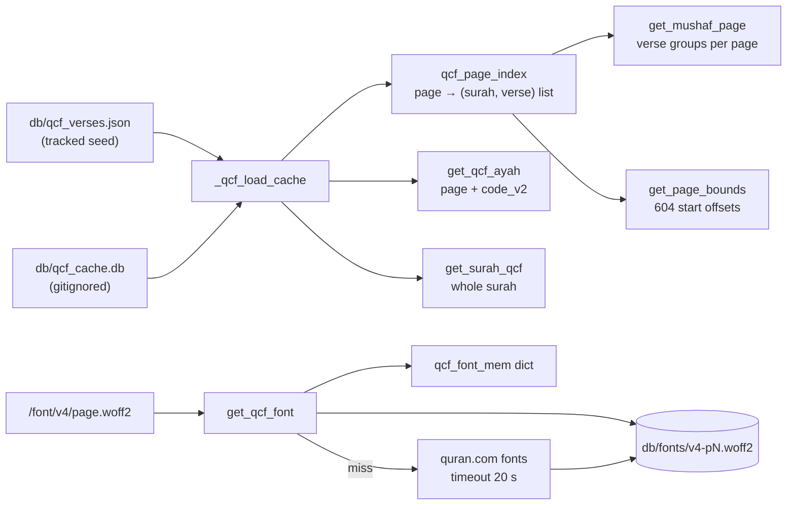

- `_qcf_load_cache()` loads the seed once into `qcf_mem`
  (`{(surah, verse): (page, code_v2)}`). It then builds `qcf_page_index`
  (`{page: ((surah, verse), …)}`). A lock prevents a half-filled cache on
  the first concurrent requests. If the seed is missing, the function falls
  back to the SQLite cache.
- `get_qcf_ayah()` can still fetch from quran.com for a broken install. The
  fetch has a 6 s timeout, a 15 s cooldown, and writes to
  `db/qcf_cache.db`.
- `peek_qcf_ayah()` **never touches the network**. The whole-surah carousel
  uses it so that Al-Baqarah cannot stall on 286 HTTP calls.
- `get_qcf_font(page)` reads `db/fonts/v4-p{page}.woff2`. On a miss it
  downloads the font from quran.com and caches it on disk and in memory.
  The route serves fonts as `public, max-age=31536000, immutable`.

Page membership follows the V2 mushaf everywhere: `get_mushaf_page`,
`get_page_bounds`, the reading map, and the verse list for
`/mushaf/<surah>`.
---

### 4.5 Verse payloads

There are two payload shapes and five consumers.

| Function | Shape | Consumer | Notes |
|---|---|---|---|
| `get_verse_pickle(s, v)` | dict, unpickled from `db2` | low level | one BLOB per verse |
| `p_getSurahInfo(s, v)` | full dict + root defs + AI HTML + tajweed + QCF | `/<surah>/`, section API | applies `RootDefAdder`, warmers |
| `get_verse_details(s, v)` | deep copy of `_verse_details_cached` (`lru_cache(24)`) | `/<surah>/`, section API | callers can mutate |
| `get_verse_core(s, v)` | 7 keys + `ayah_tajweed`, `qcf_page`, `ayah_codev2` | `/<surah>/<verse>`, `/api/v1/verse/<s>/<v>` | the page ships only this |
| `get_surah_core(s)` | `{surah, name, count, verses, prev, next}` | `/api/v1/surah/<n>` | `lru_cache(4)` |

`p_getSurahInfo` builds:

```
surah_name, surah, verse, prev, next, ayah, translation,
wordforword, definitions, morph, en_kathir, bn_zakaria,
ayah_tajweed, qcf_page, ayah_codev2, ai_explanation
```

`RootDefAdder` (inside `library.py`) decorates the pickle's morphology with
`db/sarf.json` root definitions. It normalises `/` in definitions. It reads
the AI explanation from `db/ai_context.db`. The column
`verse_analysis.verse` is **0-based**. The code applies `verse - 1`.

**Why a core payload exists:** the full payload carries morphology,
word-for-word, definitions and two tafsir bodies. That is tens of KB. The
first page load ships only the core. The accordions (`ai`, `wfw`, `defs`,
`morph`, `bn`, `en`) load on demand from `/api/v1/verse/<s>/<v>/<section>`.
The section API renders the same Jinja partials as the page. One source of
truth for the markup.

### 4.6 Surah-wide readers

| Function | Source | Caching | Used by |
|---|---|---|---|
| `get_full_arabic(surah)` | `_quran_text()` + `quran_stat` | `lru_cache(8)` | `/mushaf`, `/translation`, `get_mushaf_page` |
| `get_full_tranlation(surah)` | `_quran_translation()` | `lru_cache(8)` | `/translation`, `/mushaf`, `get_mushaf_page` |
| `get_full_en_tafsir(surah)` | `db/en_kathir.db` | none | `/tafsir/en` |
| `get_full_bn_tafsir(surah)` | `db/bn_zakaria.db` | none | `/tafsir/bn` |
| `get_surah_qcf(surah)` | `qcf_mem` | none | `/mushaf` |
| `get_surah_core(surah)` | Arabic + translation + QCF | `lru_cache(4)` | `/api/v1/surah/<n>` |

All return `(surah_name, ((verse_no, text), …))`, except `get_surah_core`.
The tafsir readers re-read `quran_stat.json` on each call instead of using
the `quran_stat()` cache. The file is about 9 KB, so this is harmless.

### 4.7 Mushaf page and printed line layout

`get_mushaf_page(page)` returns a page as surah groups:

```
{
  page, prev, next,
  groups: (
    {surah, name, start, bismillah,
     rows: ({surah, verse, surah_name, arabic, translation,
             qcf_page, codev2, start, bismillah}, …)},
    …
  ),
  surah_names, count
}
```

- Membership comes from `qcf_page_index` (V2 pages).
- A page can span up to three surahs. Each group gets a banner and a
  basmala only when it contains that surah's first verse. Surahs 1 and 9
  never get a basmala row.
- The route uses `lru_cache(8)`. The heavy per-surah data comes from the
  cached `get_full_arabic` and `get_full_tranlation`.
- Prev/next wrap: page 1 → 604, page 604 → 1.

`get_mushaf_lines(page)` returns the printed line layout from
`db/mushaf_lines.json` (about 2 MB, tracked). The file is generated from
[zonetecde/mushaf-layout](https://github.com/zonetecde/mushaf-layout)
QPC2 pages:

```json
{"pages": {"604": [["h", 112], ["b"], ["x", [[112, 1, "glyphs", "plain text"], …]], …]}}
```

`h` is a surah banner. `b` is a basmala. `x` is a text line. Its segments
are `[surah, verse, glyphs, plain Uthmani text]`. `_mushaf_lines()` loads
and parses the file once under a lock. `_mushaf_fix_banners()` moves a
surah banner that upstream put at the **bottom of the previous page** to
the top of the page where the surah starts (18 cases). The plain fragment
gets its Arabic-Indic verse number wrapped in parentheses (`(٢٥٥)`) in
`get_mushaf_lines`. The normal-font view has no ornate QCF ayah marker.

`get_mushaf_lines` is `lru_cache(16)`. It returns typed dicts
(`header` / `basmala` / `text` with `endblock`). `templates/mushaf_page.html`
renders them.

### 4.8 Overviews

Two tables, identical in shape. Both are generated offline and committed.

| Table | Key | Columns | Reader |
|---|---|---|---|
| `page_overviews` | `page` 1–604 | `context`, `summary`, `model`, `generated_at` | `get_page_overview(page)` |
| `surah_overviews` | `surah` 1–114 | same | `get_surah_overview(surah)` |

Both readers return `{'context', 'summary'}` or `None`. `None` hides the
accordion. Both use `lru_cache(128)` and a parameterised query. The surah
overview is included by `comprehensive.html`. It appears on `/translation`,
`/mushaf`, `/tafsir/en` and `/tafsir/bn`. The page overview appears only on
`/page/<n>`.

### 4.9 Reading-map helpers

| Function | Result | Notes |
|---|---|---|
| `surah_starts()` | 114 ints | 0-based flat index of each surah's first verse; `lru_cache(1)` |
| `verse_index(s, v)` | 0–6235 | `surah_starts[s-1] + v - 1`; validates bounds |
| `get_page_bounds()` | 604 ints | Start offset of each page, derived from `qcf_page_index`; returns `()` if the total is not exactly 6,236 |
| `get_ayah_themes()` | `{themes, verses}` | 12 themes + 6,236-entry canonical-order id array; empty lists if the DB is missing or incomplete |
| `get_surah_themes(surah)` | theme ids for one surah | for the verse page's pill |
| `get_theme_page(theme_id)` | rows + count + prev/next | `lru_cache(12)`; returns `None` on missing/out-of-range data |

The map page renders `window.AAYATUN_PAGE_BOUNDS` and
`window.AAYATUN_THEMES` so the client needs no extra request and works
offline. `verse_index` feeds `<meta name="aayatun-read-index">` on verse and
page views.

`get_theme_page` builds the rows for `/theme/<theme_id>`:

- It walks surahs 1–114 in order.
- For each matching verse it stores: `surah`, `verse`, short `surah_name`
  (the qualifier in parentheses is removed), `arabic`, `translation`,
  `qcf_page`, `codev2`.
- It also returns the rotated prev/next theme ids.
- The table is flat. There are no group header rows. This keeps
  DataTables pagination and search valid.

### 4.10 Legacy and unused paths

`getSurahInfo`, `get_morph`, `get_word_for_word_meaning`,
`get_word_definions`, `get_related_meanings`, `get_combined_df` read
`db/corpus.db`, `db/words.db` and `db/all_word_def.json`. These files are
**not in the repository**. The functions are unreachable from live routes.
They are kept for reference. Do not wire them back in without restoring
those databases.

`db/search.db` (gitignored, ~125 MB) is built by `build_search.py`. Arabic
is indexed in normalized form (diacritics stripped, alif/hamza/ya/ta-marbuta
unified) and rendered from the original Uthmani text. All columns are
stored normalized with raw text as `UNINDEXED` display columns. The
`docs_trgm` trigram table is skipped on hosts whose SQLite lacks the
trigram tokenizer (needs SQLite >= 3.34, e.g. PythonAnywhere). Ranking is
BM25 with per-column weights emitted as OR'ed column-filtered clauses
(plain unfiltered FTS5 matches flatten the weights). Multi-word queries run
an all-tokens pass first and merge those rows in front of the OR pass.
Complete matches always outrank partial matches. A trailing `*` acts as a
prefix wildcard. The `db3/` Whoosh index is gone.

### 4.11 In-process caches

| Object | Size | Purpose |
|---|---|---|
| `quran_stat()` | 1 | Surah names and counts |
| `_text_mem` | 2 dicts | Arabic + English text tables (~1.2 MB) |
| `tajweed_mem` | all cached rows | Markup strings |
| `_fetch_tajweed_ayah` | 6,236 | Per-verse fetch cache |
| `qcf_mem` | 6,236 | `(page, code_v2)` |
| `qcf_page_index` | 604 | Page → verses |
| `qcf_font_mem` | per page | Font bytes |
| `_mushaf_lines_mem` | 604 pages | Parsed line layout |
| `_tajweed_warmed` / `_surah_warmed` | sets | Duplicate warmer guards |
| `_verse_details_cached` | 24 | Full payload, deep-copied |
| `get_full_arabic` / `get_full_tranlation` | 8 each | Surah text |
| `get_full_en_tafsir` / `get_full_bn_tafsir` | 8 each | Tafsir |
| `get_mushaf_page` | 8 | Page groups |
| `get_mushaf_lines` | 16 | Typed lines |
| `get_page_overview` / `get_surah_overview` | 128 each | AI overview rows |
| `get_theme_page` | 12 | Theme rows |
| `get_surah_core` | 4 | Carousel payload |
| `_surah_payload` (app.py) | 8 | Gzipped JSON bytes |

The mutating caches use `threading.Lock` (text tables, QCF load, mushaf
JSON). Flask's dev server and production workers handle requests in
threads.
---

## 5. Module data stores

### 5.1 Store map

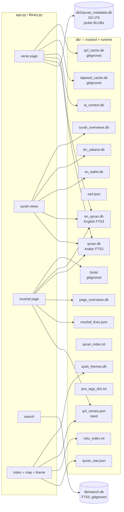

### 5.2 `db/` — the main data directory

Names are misleading. Read this table, not the filenames.

| File | Size | Shape | Tracked? | Purpose |
|---|---|---|---|---|
| `quran.db` | 2.6 MB | FTS3 `verses(sura, ayah, text)` | yes | Plain Uthmani Arabic |
| `en_quran.db` | 2.0 MB | FTS3 `verses(sura, ayah, text)` | yes | English translation |
| `en_kathir.db` | 12.7 MB | `tafsir_kathir(surah, ayah, tafsir_text)` | yes | Ibn Kathir English tafsir |
| `bn_zakaria.db` | 20.6 MB | `verses(sura, ayah, text)` | yes | Abu Bakr Zakaria Bangla tafsir |
| `ai_context.db` | 31.9 MB | `verse_analysis(surah, verse 0-based, content)` | yes | AI word/verse analysis; `content` is a Python-literal dict read with `eval` |
| `quran_stat.json` | 9.5 KB | DataFrame | yes | `Surah` names + `Verses` counts |
| `sarf.json` | 1.4 MB | DataFrame | yes | Root → baab/form/description |
| `qcf_verses.json` | 434 KB | `{"verses": [[s,v,page,code_v2], …]}` | yes | QCF text + V2 page membership |
| `mushaf_lines.json` | 2.0 MB | `{"pages": {"N": [lines]}}` | yes | Printed line layout, 604 pages |
| `page_overviews.db` | 840 KB | `page_overviews(page, context, summary, model, generated_at)` | yes | AI page orientation |
| `surah_overviews.db` | 180 KB | `surah_overviews(surah, context, summary, model, generated_at)` | yes | AI surah orientation |
| `ayah_themes.db` | ~180 KB | `themes(id, name, color)` + `verse_themes(surah, verse, theme_id)` | yes | 12 one-word themes, one per ayah |
| `quran_index.txt` | 61 KB | Python literal list of `(surah, verse)` | yes | Flat mushaf order |
| `ruku_index.txt` | 5.4 KB | Python literal list of `(surah, verse)` | yes | Ruku starts; random **Surprise me!** |
| `pos_tags_dict.txt` | 1.3 KB | Python literal dict | yes | POS tag → description |
| `tajweed_cache.db` | 1.6 MB | `taj(sura, ayah, markup)` | **no** | Runtime tajweed cache |
| `qcf_cache.db` | 274 KB | `qcf(sura, ayah, page, codev2)` | **no** | Seed fallback / network cache |
| `fonts/v4-pN.woff2` | — | binary | **no** | Downloaded QCF page fonts |
| `.secret_key` | 64 B | hex | **no** | Flask session key fallback |

The `.txt` indexes are **Python literals**, not JSON. They are read with
`ast.literal_eval` (`ruku_index.txt`) or `eval` (`quran_index.txt`,
`pos_tags_dict.txt`). Keep them valid Python when regenerating.

### 5.3 `db2/` — verse metadata (Git LFS)

`db2/quran_metadata.db` (~311 MB) holds `verses(surah, verse, data)` where
`data` is a pickled Python dict. `get_verse_pickle` selects one row and
unpickles it. This is the backbone of every verse page: `ayah`,
`translation`, `prev`, `next`, word-for-word, definitions, morphology, both
tafsirs and the AI explanation. Without `git lfs pull`, verse pages fail.

### 5.4 `db/search.db` — FTS5 search index

`build_search.py` (run from the repository root; also invoked once by
`searchtool._ensure_db()` if the file is missing) reads
`db/quran.db`, `db/en_quran.db`, `db/en_kathir.db`, `db/bn_zakaria.db`,
`db/ai_context.db` (flattened) and `db/quran_stat.json`. It strips HTML,
it normalizes text (via `searchnorm.normalize`), and writes two tables:

- `docs`: all columns plus raw display columns as `UNINDEXED`. BM25
  weights: ar/en 10, AI 1.5, tafsirs 2, surah name 3.
- `docs_trgm`: trigram over Arabic and English text. Used for the
  substring/root-search fallback. Skipped on hosts whose SQLite lacks
  the trigram tokenizer (needs SQLite >= 3.34, e.g. PythonAnywhere).

It also writes `db/search_vocab.pkl` (token → frequency, ~30 k entries).
This powers edit-distance “did you mean” suggestions via a BK-tree built
lazily on the zero-hit path. `db/search_synonyms.json` holds curated synonym
groups (English transliteration/Quranic terms + a small Arabic set). A
glossary hit ORs the whole group into the query. Highlighting wraps the
original (diacritized) text using a normalized→original index map, escaping
via `_render` in `searchnorm.py`. Bengali has no stemming. It matches on
exact tokens and trigram substrings (where the host's SQLite provides them).

---

## 6. Module templates

### 6.1 Inheritance

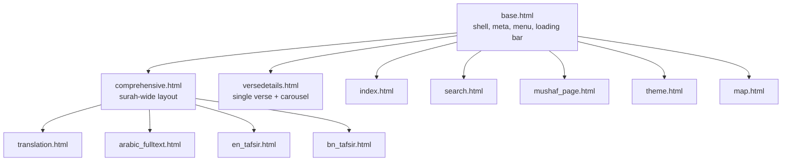

### 6.2 `base.html` — the shell

Responsible for:

- Early head script: applies `html.dark-theme` from
  `localStorage['darktheme']` before first paint. Restores the loading bar
  from `sessionStorage['aayatun_loading']`.
- Meta: `theme-color`, viewport, manifest, iOS meta tags, default
  description/OG/Twitter tags (`og:site_name/type/title/description/url/image`,
  `twitter:card=summary`; `twitter:*` reuses `self.og_*()`).
- CSS: Fomantic CDN, `static/css/style.css`, Google Fonts
  (Open Sans, Merriweather, Amiri, Scheherazade, Lora, Baloo Da 2).
- Scripts: deferred jQuery + Fomantic, `recent.js`, `share.js`; pages add
  their own via ``.
- The menu bar (``), the search modal, the loading bar and
  the content container.
- The loading-bar controller (`showLoading`/`hideLoading`). It lives outside
  jQuery and `DOMContentLoaded`. It hooks link clicks in the capture phase
  and form submits. It exposes `AayatunNav.go(url[, replace])` for
  programmatic navigation (also shows the parent page's bar from the
  verse-modal iframe). It honours `data-loading`/`data-navigate` buttons.
  Inline `onclick` handlers that assign `location.href`/`replace`/`assign`
  are caught as a fallback.
- Blocks: `title`, `meta_description`, `og_type`, `og_title`,
  `og_description`, `js`, `head_extra`, `start`, `menu`, `content`,
  `content2`, `content3`, `end_`, `scriptcontent`.

### 6.3 `comprehensive.html` — surah-wide pages

Used by `/translation`, `/mushaf`, `/tafsir/en`, `/tafsir/bn`. The theme
page (`theme.html`) also extends it.

- Menu: prev/next arrows with `url_for` targets from each child.
- Includes `partials/_verse_modal.html` (the shared verse iframe modal).
- Includes `partials/_surah_overview.html` above the options block.
- Two child-overridable blocks control the body:
  - `` — default renders the surah `<h4>` (link
    to the surah's first verse) followed by an optional
    `` line (“English Translation of Surah 2”,
    “Tafsir Ibn Kathir of Surah 2”, “Bangla Tafsir of Surah 2”,
    “Arabic Text of Surah 2”). A muted small `.page-subtitle` styles it.
  - `` — default renders the per-verse rows. The
    theme page overrides this block to print multi-surah rows.
- Provides `` (toggles) and ``.
  The Arabic view supplies a `<template>` containing a real two-cell row.
  `drawCallback` clones it to the start of page one's `<tbody>` after every
  DataTables draw. The basmala stays under the search controls with the
  verses. It is not sortable and not part of pagination.
- Renders one repeated block per verse with a `font_config` block that each
  child overrides (Scheherazade 225 % for Arabic, Lora for translation,
  Baloo Da 2 1.15 rem for Bangla).
- DataTables keeps pagination and state on (`paging`, `stateSave`,
  `lengthChange` true). The `` blocks only choose the mushaf
  markup (`mushaf-ayah`, the hidden QCF span and the extra translation).
- The verse reference cell uses Lora 110 % everywhere.
---

### 6.4 `versedetails.html` — the verse page

The most scripted template.

- Head: `qcf-font.js` and a parse-time tajweed init. The init adds
  `html.tajweed-pending`. The plain `h1` stays invisible until the coloured
  rendering is applied.
- Menu: prev/next verse arrows (`onclick="navigateVerse(...)"`), surah:verse
  link, home link.
- `#pagecontent` with two viewports/tracks:
  - `#ayah-viewport` / `#ayah-track`: three panes. The centre pane holds
    `#ayah` (only one `id="ayah"` exists at a time). Neighbours are
    `div.ayah-text`.
  - `#translation-viewport` / `#translation-track`: same three-pane model.
- Hidden sources: `#ayah-codev2` (`data-page`, `data-text`),
  `#ayah-markup-src`, `#ayah-plain-src`.
- Tajweed legend, credits (King Fahd Complex, quran.com, Al Quran Cloud).
- Audio box (everyayah.com MP3, `preload="none"`), loop/tajweed/close
  controls.
- Control row: More, share, **Mushaf** jump (removed inside an iframe),
  tajweed, play, theme pill, **Show Verse Themes** is not on this page.
- Theme pill: a link to `/theme/<id>?v=<surah>:<verse>`. It is updated on
  `aayatun:verse`. Inside the modal iframe it navigates the parent page.
- `#verse-sections` accordion with `data-section` and `data-loaded` for
  `ai`, `wfw`, `defs`, `morph`, `bn`, `en`. The `grammar` section is static
  and links to Corpus Quran.
- `verse-nav.js` loads with `defer`. The page ships only the core payload.
- The API token is in `<meta name="aayatun-api-token">`.

### 6.5 `mushaf_page.html` — `/page/<n>`

Extends `base.html` directly (not `comprehensive.html`). It contains two
views over the same page:

1. **Table view** — `#mushaf-page-table`, one row per verse grouped by
   surah, with `mushaf-ayah` spans holding both `.mushaf-plain` and
   `.mushaf-qcf`.
2. **Printed layout view** — `#mushaf-layout`, lines from
   `library.get_mushaf_lines`, with clickable verse segments and a credit
   line.

Both views start with `partials/_mushaf_zoom.html`. The page-overview
accordion sits above the controls (`partials/_ai_notice.html` + context +
summary). A small muted subtitle above the surah list reads
“Madani Mushaf Page N” (`.page-subtitle.page-subtitle-lg`). The layout view
is the default and is persisted in `localStorage['aayatun_mushaf_layout_v1']`.
A head script hides the table before first paint so it never flashes.
Tajweed is on by default here.

The inline script:

- Fits printed lines by measuring at 100 px and scaling the widest line,
  re-fitting on resize, tajweed toggle and zoom change.
- Caps pages 1–2 at a smaller size because their printed lines are short.
- Justifies every line except `endblock` lines.
- Paints `.mushaf-seg-active` on every segment of a verse (a verse split
  across lines shares one `data-surah`/`data-verse`).
- Implements swipe navigation (pointer drag, 25 %/velocity commit, 1:1
  follow-the-finger, neighbour prefetch), keyboard arrows, and the
  `?v=surah:verse` jump highlight.
- Hides the layout until the active face (QCF or plain) is painted and
  fitted.
- Fades between table and lines on the layout toggle (~170 ms).

### 6.6 `index.html`

- Hero, surah picker (`#surah` options are also the map's surah table).
- **Go** button, **Surprise me!** (`surpriseTarget()`: 50 % random page,
  otherwise the server-picked ruku verse), and the **Quran Exploration
  Map** button beside it in `.home-actions-row`.
- **Recently Read** chips rendered by `recent.js`.
- The clear-history confirmation modal (`#clear-history-modal`).
- The iOS install banner (`#ios-install-modal`).
- Footer: the repo link on the “Aayatun v2.0” label, the **Dark Theme**
  toggle, and the **More Apps** pointing popup (`#more-apps-popup`) which
  lists Prayer Time and Counter.
- Two lines of **whole-surah** buttons:
  - Line 1: Arabic · Translation · Mushaf
  - Line 2: Tafsir (English) · Tafsir (Bengali)
  Clicks bind URLs by DOM order (`target_location`). Keep DOM order and
  that array in sync.
- `window.AAYATUN_PAGE_BOUNDS` is injected in the head.
- Registers the service worker (`static/service-worker.js`).
- Uses **CRLF** line endings; edit with care to keep diffs minimal.

### 6.7 `search.html`

Renders `results` (list of dicts from `searchtool`), `suggestions` (list of
correction tokens), `corrected` (auto-correction banner text when a
zero-hit query was re-run against edited tokens), `query`, `limit_label`
and `filter_value`. Each result row carries `chips` (match locations:
verse / translation / tafsir I.K. / tafsir Z. / AI explanation) and
per-column snippets with the matched text wrapped in
`<span class="match">`. It includes the shared verse modal so a result can
open the verse in place.

### 6.8 `map.html` — Quran Exploration Map

Served at `/map` (`app.py: reading_map`). It renders one square per verse in
canonical mushaf order (6,236 squares, GitHub-contribution style). The page
inodes no modal; the index navigates to it with `AayatunNav.go('/map')`.

- Legend: `Unread`, `Page visited`, `Less/More` around the three deep
  shades; in theme mode `Unread` + `Read` with a ticked swatch.
- Theme mode (`#reading-map-themes`): cell fill carries the theme; every
  read verse (state ≥ 1) gets a white tick. The 12-theme legend is sorted
  by frequency. Tapping a theme highlights it. The switch position is
  remembered in `localStorage['aayatun_read_map_themes_v1']`.
- Cards row (`.reading-map-cards`): a lead card (selected-verse readout,
  prev/next chevron buttons, the verse's translation in a reserved two-line
  box), a stats card with two progress rings, and a share card. The lead
  card keeps a **fixed** height; rows are reservation-sized.
- Fixed-height frame (`layoutMap()`): the frame clamps to
  `[126px, 70% vh]` with at least 12 rows. Zoom re-wraps cells inside the
  frame and never resizes it.
- One-way horizontal scroll; native scrollbar hidden, custom
  `.reading-map-scrollbar` with a draggable thumb (track click, Home/End,
  Arrow keys, `role="scrollbar"`).
- Prev/next chevrons step the selection one verse backward/forward. The
  map scrolls the selected cell into view.
- Theme attribution line: “Verse themes: AI-assisted (Aayatun)”.

### 6.9 `theme.html` — `/theme/<theme_id>`

Extends `comprehensive.html`. Shows every verse tagged with one of the 12
AI-assisted themes, in canonical mushaf order, as a flat DataTable (like
the surah pages).

- Header: prev arrow, theme name (Merriweather, caret, links to `/`), next
  arrow. The name is a **button** (`#theme-menu-btn`) that toggles a
  Fomantic `pointing popup` (`#theme-menu-popup`). The popup lists the
  twelve themes (colored dot + name; the current one is bold with
  `aria-current="page"`), a hairline divider, then `<i> Home Page`.
- Heading: a live line “Showing X–Y of Z verses about <Theme>”
  (`#theme-page-count`, `aria-live="polite"`). It updates on every
  DataTables draw. When a search filter applies it shows the filtered
  count and “(filtered from N)”.
- Rows: `S:V` cell with `data-order` = zero-padded `surah*1000+verse` so
  the default sort is mushaf order, surah name below in small muted text,
  `showModal(S, V)` on click, QCF Arabic + translation.
- `?v=<surah>:<verse>` jumps the table to the verse's page and paints a
  4 s `.mushaf-row-jump` highlight. A saved search that excludes the verse
  is cleared first.
- Share is text-only (link with the count and `#aayatun`), no canvas card.
- The page registers `pages.COMP_THEME = 7` for the index's
  continue-reading link.

### 6.10 Partials

| Partial | Purpose |
|---|---|
| `_verse_modal.html` | Shared Fomantic modal with an iframe. Used on `/search` and the mushaf views. Reveals on iframe `DOMContentLoaded` (polled 40 ms). Pauses/rewinds audio on hide. |
| `_ai_notice.html` | Shared AI warning banner (page/surah overview, verse AI section). |
| `_surah_overview.html` | Surah Overview accordion (`context`, `summary`). Included by `comprehensive.html`. |
| `_mushaf_zoom.html` | −/+ zoom stepper with a `NNN%` readout. Used by both mushaf views. |
| `_share_macros.html` | Renders the share button with `data-share-*` payload (including `data-share-card` JSON and `data-share-more`). |
| `_section_ai.html` | AI explanation section. |
| `_section_wfw.html` | Word-for-word section. |
| `_section_defs.html` | Definitions section. |
| `_section_morph.html` | Morphology section (root, lemma, verb table, annotations). |
| `_section_bn.html` / `_section_en.html` | Bangla / English tafsir sections. |

### 6.11 SEO and share metadata

- `base.html` owns the defaults. Reading templates override
  `og_title`/`og_description`. The verse page also sets `og_type=article`
  and `meta_description`.
- The verse page's OG image is the site icon. Share cards are client-drawn
  PNGs handed to the Web Share API.
- `mushaf_page.html` uses the page overview's summary as its description
  when present.
---

## 7. Module client JavaScript

| Module | Loaded by | Responsibility |
|---|---|---|
| `script.js` | `base.html` (blocking, before content) | Dark theme, page-type constants, menu/search modal helpers |
| `recent.js` | `base.html` (deferred, every page) | Recently Read list + reading-map bitsets |
| `share.js` | `base.html` (deferred, every page) | Share text + canvas cards + Web Share/clipboard |
| `qcf-font.js` | verse page, mushaf page, surah page, theme page | QCF font loading, palette, toggle persistence |
| `verse-nav.js` | verse page (deferred) | Carousel, surah payload LRU, section fetch, offline verses |
| `mushaf-zoom.js` | mushaf views + theme page | Zoom steps, `--mushaf-zoom`, refit callback |
| `reading-map.js` | map page (deferred) | 6,236-square map, selection, scrollbar, share data |
| `install.js` | prayer-time, daily-counter | Install prompt flow |
| `swiped-events.min.js` | legacy vendored | Not used by current templates |

### 7.1 `qcf-font.js`

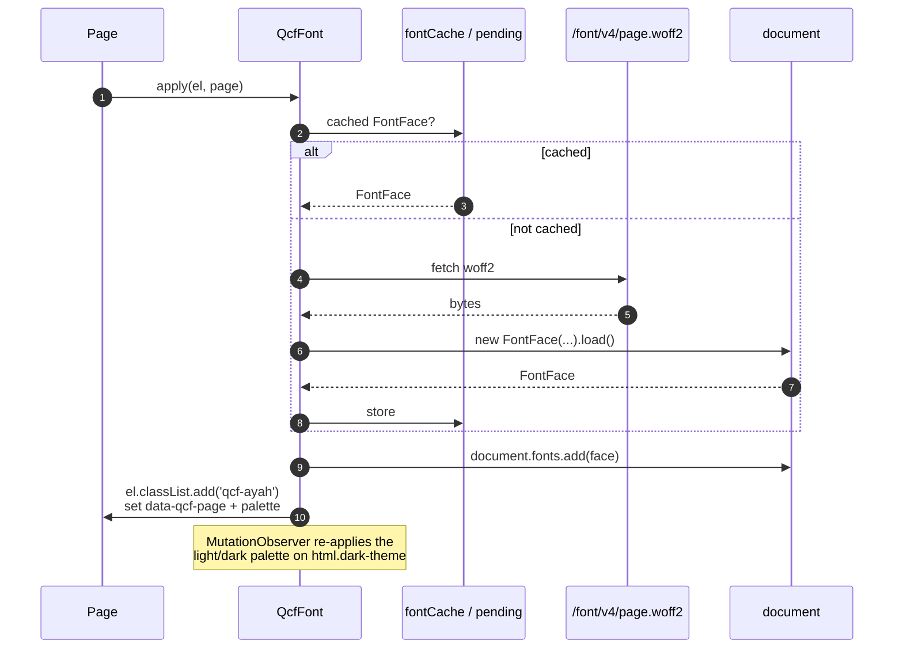

Public API: `get`, `setOn`, `isOn`, `supports`, `load`, `isLoaded`,
`apply`, `clear`. The on/off choice is `localStorage['ayahTajweedOn']`.
It is shared by all surfaces. Fonts are per page, so a page only downloads
the font(s) it shows. Neighbours are prefetched by `verse-nav.js` and by
the mushaf page.

### 7.2 `verse-nav.js` — the carousel

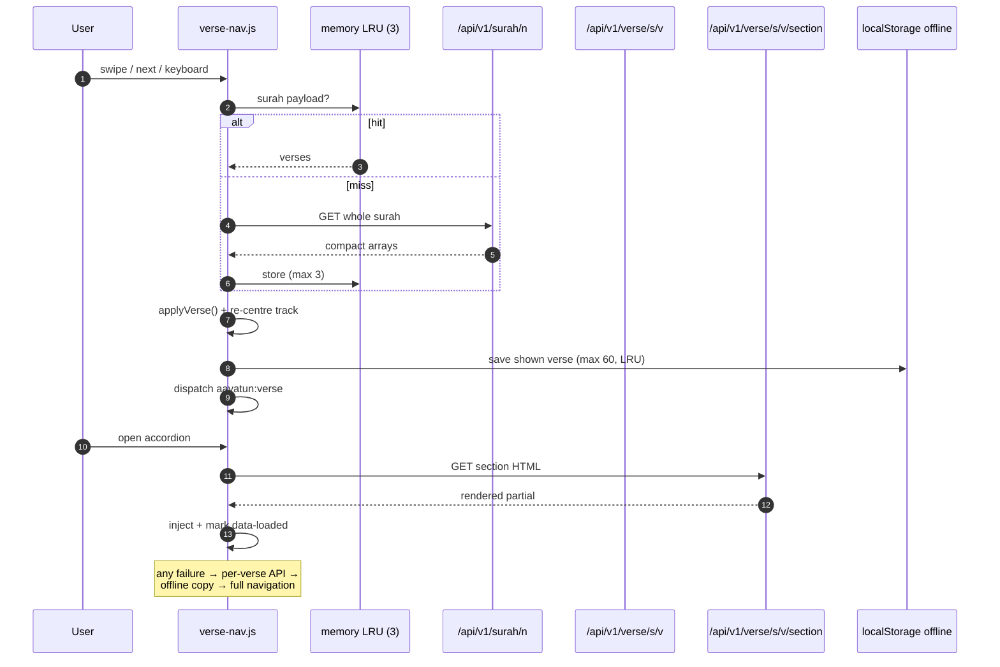

Details:

- **Memory-only** surah LRU (3 entries). No sessionStorage, IndexedDB or
  service-worker caching of payloads.
- Two 3-pane tracks (Arabic + translation) with pointer-drag axis detection,
  25 %/velocity commit, follow-the-finger, then `applyVerse()` and an
  instant re-centre.
- The only `id="ayah"` lives on the centre pane. Neighbours are
  `div.ayah-text`.
- Accordion sections are fetched on demand and only once (`data-loaded`).
- Every verse shown is written to `localStorage['aayatun_verse_offline_v1']`
  (max 60, LRU by timestamp). Offline, `dataFor`/`loadVerse` read that. A
  failed navigation with nothing cached falls to `static/offline.html`.
- `applyVerse()` dispatches `aayatun:verse`. `recent.js` uses it to update
  the map (and the verse chip, except inside the modal iframe).
- The module exits early on pages without `#pagecontent` or a token meta.

### 7.3 `mushaf-zoom.js`

Four steps (100/125/150/175 %) stored in
`localStorage['aayatun_mushaf_zoom_v1']`. Shared by `/page/<n>` and
`/mushaf/<surah>`. It writes `--mushaf-zoom`, which `style.css` multiplies
into `.mushaf-ayah` (225 % plain, 165 % QCF). Tables simply reflow. The
printed layout is px-sized, so it refits through `MushafZoom.onChange`.

### 7.4 `recent.js` — Recently Read + reading map

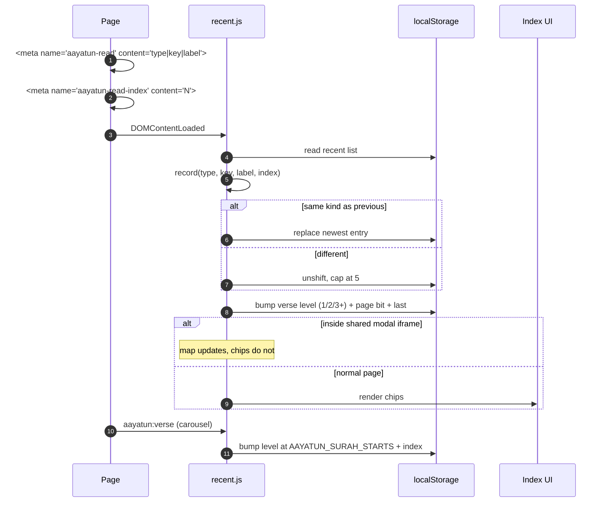

- `localStorage['aayatun_recent_reads_v1']`: max 5, newest first, runs of
  the same kind collapse (42 → 43 → 44 leaves only “Page 44”).
- `localStorage['aayatun_read_map_v2']`: two bits per verse
  (0/1/2/3 = never/1×/2×/3+×), 604 page bits and `last`. A legacy
  `aayatun_read_map_v1` bitset is migrated as “opened once”.
- A verse page opened in the shared modal marks the map but leaves the
  chips behind the modal unchanged. `record()` updates the map *before*
  its `window.self !== window.top` return.
- `clearAll()` removes both keys. The map page's **Delete** button calls it
  and then `AayatunReadingMap.refresh()`.
- Pages without the meta (home, search, translation, tafsir, prayer-time)
  never record.

### 7.5 `reading-map.js` — Quran Exploration Map

- 6,236 squares in canonical mushaf order, GitHub-contribution style.
- 10 px squares, 3 px gap, 2 px radius. `grid-auto-flow: column`. One
  blank `.rg-break` cell before each surah (113 breaks).
- States: page-view tint and three deeper greens (`0`–`4`). A deeper level
  always beats the tint.
- No network. Data comes from `recent.js` bitsets, the page mapping is
  `window.AAYATUN_PAGE_BOUNDS`, surah names/counts come from `#surah`.
- `layoutMap()` sizes the frame once (the space under the map, clamped to
  `[126px, 70% vh]`, at least 12 rows) with a fixed height. Zoom only
  re-wraps the cells inside it. It never resizes the frame. It is
  re-measured on resize.
- One-way scroll: the grid scrolls horizontally only. A custom thumb
  (`.reading-map-scrollbar`, `role="scrollbar"`) replaces the hidden native
  scrollbar, with track click, Home/End/Arrows.
- Clicking a square selects it (readout + border stay on it; hover only
  previews). Clicking **anywhere outside the grid** clears the selection and
  restores the hint.
- The Themes switch flips the map into theme mode: the cell fill carries the
  theme; every read verse (state ≥ 1) gets a white tick. The 12-theme legend
  is sorted by frequency. Tapping a theme highlights it until tapped again
  or theme mode is switched off.
- The share card is drawn by `share.js` from the same state array. Only the
  shared image is subsampled (6,236 verses → 84×42 cells). The page grid is
  never subsampled. The poster order is title → progress rings → bitmap →
  dated “Every square is one verse …” message → “What the colours mean” key
  → site band.

### 7.6 `share.js`

Two outputs from one module: **text** and an optional **PNG card**.

**Text** — the URL lives inside the text (never a separate `url` field) so
it cannot be dropped or duplicated:

| View | Format |
|---|---|
| Verse | `S:V`, blank line, translation, `Read on Aayatun: URL`, `#aayatun` |
| Surah | `Surah Name (N) — <view label> on Aayatun.` + URL + `#aayatun` |
| Page | `Mushaf page N — range` + `Read on Aayatun: URL` + `#aayatun` |
| Theme | `Theme ‘<name>’ — <count> verses of the Quran on Aayatun.` + `Read on Aayatun: URL` + `#aayatun` |

Order: `navigator.share` (with the card when one exists) → clipboard +
checkmark → `window.prompt`. There is no download fallback.

**Card** — drawn on a canvas, never a screenshot:

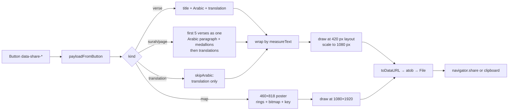

- Reading cards are laid out at **420 px** and rendered at **1080 px**
  wide. The map poster is a **460×818** layout rendered at **1080×1920**.
- Arabic uses `state.ayah` for the single-verse card. Multi-verse cards use
  the server's plain Uthmani rows (never `code_v2`), so a card is never
  coloured.
- End-of-ayah medallion: `U+06DD` + Arabic-Indic digits. Medallions are
  word-tokens; a medallion may overhang the previous line but never starts
  one.
- Title in Merriweather (`#4183C4`, `#9CC4FF` dark). Subtitle carries the
  view or the page's verse range.
- The multi-verse card shrinks both faces (31/15 → 21/12 px) until the body
  fits 1320 CSS px. It appends `…` when verses were dropped.
- Drawing is synchronous (`toDataURL` → `atob` → `File`) so Safari keeps
  the user activation.
- `document.fonts.load()` warms Merriweather/Scheherazade/Open Sans at
  startup with an Arabic sample. Google Fonts ships Scheherazade as
  unicode-range subsets; a bare `load()` fetched only Latin and left tofu on
  `/translation`.
- The map poster is drawn and encoded once while its page opens
  (`warmMapShare`, keyed by counts + position hash). The tap only hands
  over a finished file.
- Tafsir and theme views are text-only.

### 7.7 `script.js`

Small globals: dark-theme helpers (`set_dark_theme`, `is_dark_theme`), the
page-type constants (`pages.VERSE_DETAILS` … `pages.COMP_THEME = 7`), and the
menu/search modal wiring. It loads synchronously before the content.
The dark theme and the menu work even if later CDN scripts fail.
---

## 8. Module service worker, PWA and offline

`static/service-worker.js` is served at `/service-worker.js` (root scope).
`index.html` and both standalone pages register it. `CACHE_NAME` is
**`aayatun-v101`**; bump it whenever the precache list or the caching logic
changes.

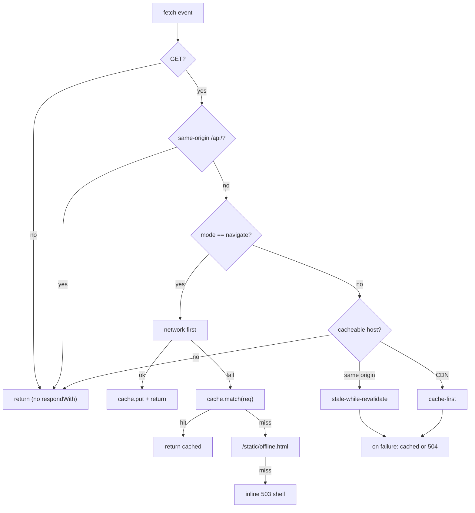

- **Precached shell** (`CORE_ASSETS`): `/`, `/map`, `/prayer-time`,
  `/daily-counter`, `/static/offline.html`, the app JS modules
  (`script`, `recent`, `share`, `reading-map`, `verse-nav`, `qcf-font`,
  `mushaf-zoom`, `install`), `style.css`, the three manifests
  (`manifest.json`, `manifest-prayer.json`, `manifest-counter.json`), the
  icons, plus the Material Symbols stylesheet Prayer Time uses for its
  sunrise/sunset pills. The install step fetches that stylesheet, pulls
  every `url(https:…)` glyph file out of it and caches those too. The icons
  survive offline.
- **Navigations**: network first, cache fallback, then `offline.html`, then
  an inline 503. Every `respondWith` path resolves to a `Response`. A failed
  fetch with nothing cached used to resolve `undefined` and throw “Failed to
  convert value to 'Response'”.
- **`/api/*` is never cached.**
- Same-origin assets use stale-while-revalidate. CDN hosts
  (`cdn.jsdelivr.net`, Google Fonts, `cdn.datatables.net`) use cache-first.
- `activate` deletes every cache whose name is not `CACHE_NAME` and claims
  clients.

**PWA**

- `static/manifest.json` fixes `id`/`scope`/`start_url` to `/`. The app must
  be installed from `https://www.aayatun.com` (the apex 301s there). An
  install from the apex stays in the in-app browser and must be removed and
  re-added.
- `static/manifest-prayer.json` and `static/manifest-counter.json` give each
  standalone tool its **own** `id`/`start_url` (`/prayer-time`,
  `/daily-counter`), so installing from that page opens that page. Both pages
  carry a `[data-install-app]` button driven by `static/js/install.js`. The
  real Chromium sheet shows when `beforeinstallprompt` fires. Otherwise a
  help sheet with the manual Share → Add to Home Screen steps shows (iOS
  never fires the event). The button is hidden in standalone mode and in
  in-app browsers.
- Chromium's `beforeinstallprompt` drives the Android/desktop banner on the
  index. iOS never fires it, so `index.html` shows a separate
  **Install Aayatun** / **How?** banner only for iOS/iPadOS (`MacIntel` +
  `maxTouchPoints > 1`). Never in standalone or an in-app browser. Dismissal
  is stored in `localStorage['aayatun_ios_install_dismissed_v1']`.

**Offline reading**

- `static/offline.html` renders the last saved verse when an uncached verse
  navigation fails offline.
- The mushaf page route sets `private, max-age=300`. The swipe handler
  prefetches the neighbour pages and their fonts so a turn is a cache hit.
- Prayer Time keeps Aladhan calendar months in
  `localStorage['prayer-times-offline-v1']` (current + next month, keyed by
  place + `method`/`school`).

---

## 9. Module external services and failure policy

| Service | Used for | Transport | Failure behaviour |
|---|---|---|---|
| `api.alquran.cloud` | Tajweed rule markup | Server, `urllib`, 4 s timeout | 15 s cooldown; verse renders plain; cached successes still work |
| `api.quran.com` | QCF `code_v2` fallback | Server, 6 s timeout | 15 s cooldown; the seed usually removes the need |
| `quran.com/fonts/…` | Per-page COLRv1 woff2 | Server, 20 s timeout on first use | `/font/v4/…` returns 404; QCF span stays hidden; plain text remains |
| `www.everyayah.com` | Recitation MP3 | Browser, `preload="none"` | audio fails; page unaffected |
| `api.aladhan.com` | Prayer times | Browser (`prayer-time.html`) | cached months still render; UI shows offline state |
| `cdn.jsdelivr.net` | jQuery, Fomantic | Browser, service-worker cached | SW cache serves the last copy |
| `fonts.googleapis.com/gstatic` | UI/Arabic fonts | Browser, SW cached | fallback font families |

The rule throughout: **a remote failure degrades one feature, never the
page.** The Quran text, translations, tafsir, metadata, QCF seed and line
layout are local. `/2/255`, `/page/42`, `/theme/4` and `/mushaf/2` render
with no outbound network at all.

---

## 10. Module caching model

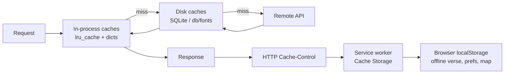

| Tier | Scope | What | Lifetime |
|---|---|---|---|
| Python dicts | Process | text tables, `tajweed_mem`, `qcf_mem`, `qcf_font_mem`, `_mushaf_lines_mem` | until restart |
| `lru_cache` | Process | see [4.11](#411-in-process-caches) | eviction by size |
| SQLite | Host | `tajweed_cache.db`, `qcf_cache.db` | permanent |
| Disk files | Host | `db/fonts/v4-pN.woff2` | permanent |
| HTTP | Browser/proxy | `private_page` (pages with token), `no-store` (API), `private, max-age=300` (mushaf + theme pages), `immutable` (fonts) | per header |
| Service worker | Browser | app shell, same-origin assets, CDN assets | `aayatun-v96` until bumped |
| `localStorage` | Browser | prefs, offline verse, recent reads, map | until cleared |

**localStorage / sessionStorage keys**

| Key | Written by | Purpose |
|---|---|---|
| `darktheme` | `script.js` / `base.html` | theme |
| `ayahTajweedOn` | `qcf-font.js` | coloured QCF face on/off |
| `aayatun_mushaf_layout_v1` | `mushaf_page.html` | printed layout vs table (only `0` means table) |
| `aayatun_mushaf_translation_v1` | `mushaf_page.html` | translation toggle |
| `aayatun_mushaf_zoom_v1` | `mushaf-zoom.js` | zoom step index |
| `aayatun_map_zoom_v1` | map page zoom stepper | zoom step index |
| `aayatun_read_map_themes_v1` | map page | themes switch position |
| `aayatun_recent_reads_v1` | `recent.js` | Recently Read (max 5) |
| `aayatun_read_map_v2` | `recent.js` | per-verse levels + page bits + `last` |
| `aayatun_read_map_v1` | old build | migrated once into v2 |
| `aayatun_verse_offline_v1` | `verse-nav.js` | last 60 shown verses |
| `aayatun_ios_install_dismissed_v1` | `index.html` | iOS banner dismissal |
| `prayer-times-offline-v1` | `prayer-time.html` | Aladhan month cache |
| `aayatun_loading` (session) | `base.html` | loading bar across navigation |
---

## 11. Module security and privacy

- **Nav API token.** `api_token()` mints a per-session token
  (`secrets.token_urlsafe(32)`). It is stored in the signed Flask session.
  The verse page renders it as `<meta name="aayatun-api-token">`. Fetch
  calls send `X-Aayatun-Token`. `require_api_token()` compares with
  `hmac.compare_digest` and checks `same_site_request()` (`Sec-Fetch-Site`
  ∈ {same-origin, same-site}, and `Origin`/`Referer` host equal to the
  request host). No CORS headers are sent, so cross-origin reads fail in
  the browser. The token stops hotlinking and third-party embedding. It
  does not stop a determined local attacker; a browser token cannot be
  secret.
- **Cache isolation.** Pages that contain the token use `private,
  max-age=0, must-revalidate`. A shared cache never hands one session's
  token to another. API responses are `private, no-store`.
- **Sessions.** `HTTPONLY`, `SAMESITE=Lax`, and `Secure` when
  `AAYATUN_HTTPS=1`. The key comes from `AAYATUN_SECRET_KEY`. Otherwise
  from `db/.secret_key` (mode 0600, atomic). Otherwise from an ephemeral
  key.
- **SQL.** Existing queries interpolate integer route params with
  f-strings. New code uses bound parameters. Treat any new string input as
  unreviewed until parameterised.
- **No secrets in the repository.** Content generators keep API keys in a
  temporary environment file and never write them to data files.
  `db/.secret_key` is gitignored.
- **Third-party content.** Tafsir and AI text is injected via `Markup`
  after the generator's own escaping (`utils.json_to_html` escapes fields).
  The AI explanation is `eval`'d from a trusted local database, never from
  user input.

---

## 12. Module offline content generation

Some data is too slow or too large to build at request time. It is
generated offline and committed.

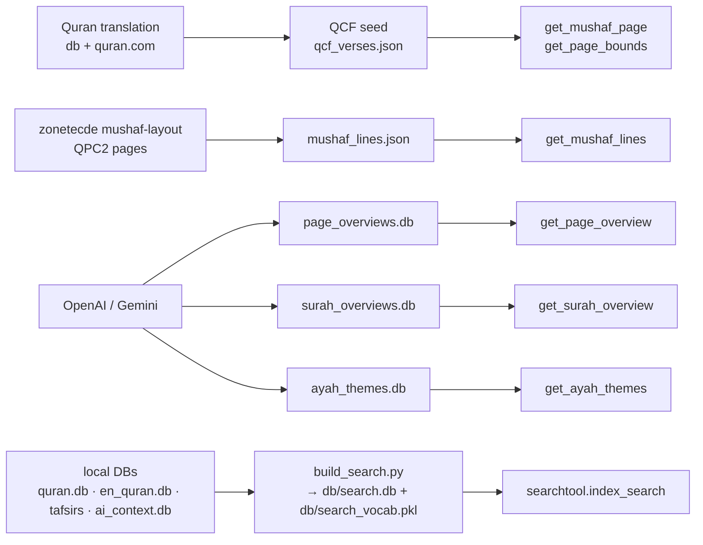

| Dataset | Generator | Rules |
|---|---|---|
| `db/qcf_verses.json` | one-off script from quran.com `by_page` endpoints | page column corrected to **V2**; 6,236 rows; source of truth for QCF text/page membership |
| `db/mushaf_lines.json` | from `zonetecde/mushaf-layout` `v2/mushaf/QPC2/page-XXX.json` | keep page membership in sync with `qcf_verses.json`; banners fixed at load |
| `db/page_overviews.db` | `/mnt/d/PROJECTS/aayatun_ai_content/generate_page_overviews.py` | batched, resumable, Gemini/OpenAI; run from the app root; one row per page |
| `db/surah_overviews.db` | `…/generate_surah_overviews.py` | batched by verse count, resumable; 114 rows |
| `db/ayah_themes.db` | `generate_ayah_themes.py` | batched by surah (40 ayahs per OpenAI call); a deterministic post-process fixes disconnected letters → Revelation plus a short manual list; 6,236 rows |
| `db/search.db` + `db/search_vocab.pkl` | `build_search.py` | run from the repo root after any source DB changes; outputs are gitignored; auto-built once by `searchtool` if missing |

Both overview generators store `model` and `generated_at`; never the API
key. The app only reads the resulting DBs. Partial generation is safe
because a missing row hides its accordion. The themes generator stores the
model too, and never the key.

---

## 13. Module operations and checklists

**Common commands**

```bash
flask --app app.py run --debug
python3 -c "import app; print(app.app.test_client().get('/2/255').status_code)"
git lfs pull
pip install -r requirements.txt
python3 build_search.py     # re-run after source DB changes
```

**Safe-to-delete runtime state**

- `db/fonts/`, `db/qcf_cache.db`, `db/tajweed_cache.db` — refetched on demand.
- `__pycache__/`.

**Change checklist**

- **Python**: use tabs, not spaces. Route params are ints; use bound
  parameters for anything new.
- **`templates/index.html`**: CRLF line endings. Do not rewrite this file;
  it creates a 2,500-line diff.
- **Service worker**: bump `CACHE_NAME` whenever `CORE_ASSETS` or the
  caching logic changes.
- **Search**: `/search` is POST-only. `db/search.db` is gitignored and
  built by `python3 build_search.py`; re-run it after any source DB
  changes. Deploy steps must include the build (or let the first search
  trigger it once).
- **Mushaf data**: `qcf_verses.json` and `mushaf_lines.json` must agree on
  page membership. Regenerate both together.
- **Overviews**: adding rows is additive; no code change is needed. The
  accordion appears automatically.
- **Themes**: the map's themes switch and the `/theme/<id>` page read the
  same database. A missing row hides the new surface.
- **Share buttons**: the `_share_macros.html` button is the only payload
  source; keep `data-share-card` single-quoted and `tojson`-escaped.
- **Verse reference column**: Lora 110 % everywhere (surah pages, tafsir,
  mushaf, theme page).
- **App-like pages**: `/` and `/map` disable text selection (except inside
  form controls).

**Deployment shape**

- One or more Flask workers behind a WSGI server. Session affinity is not
  required if `AAYATUN_SECRET_KEY` is shared. The in-process caches are
  per-worker and warm lazily.
- Serve over HTTPS and set `AAYATUN_HTTPS=1` so the session cookie is
  `Secure`.
- `db2/quran_metadata.db` must be pulled through Git LFS on deploy. The app
  cannot synthesise verse metadata.

---

## Appendix A — Route → library → template matrix

| Route | Library entry points | Template |
|---|---|---|
| `/` | `get_page_bounds`, `verse_index` (indirect), `getVerseMaps` | `index.html` |
| `/map` | `get_page_bounds`, `get_ayah_themes` | `map.html` |
| `/<s>/` | `get_verse_details`, `verse_index`, `surah_starts` | `versedetails.html` |
| `/<s>/<v>` | `get_verse_core`, `verse_index`, `surah_starts` | `versedetails.html` |
| `/translation/<s>` | `get_full_tranlation`, `get_full_arabic`, `get_surah_overview` | `translation.html` → `comprehensive.html` |
| `/mushaf/<s>` | `get_full_arabic`, `get_full_tranlation`, `get_surah_qcf`, `get_surah_overview` | `arabic_fulltext.html` → `comprehensive.html` |
| `/tafsir/en/<s>` | `get_full_en_tafsir`, `get_surah_overview` | `en_tafsir.html` → `comprehensive.html` |
| `/tafsir/bn/<s>` | `get_full_bn_tafsir`, `get_surah_overview` | `bn_tafsir.html` → `comprehensive.html` |
| `/page/<n>` | `get_mushaf_page`, `get_mushaf_lines`, `get_page_overview`, `verse_index` | `mushaf_page.html` |
| `/theme/<id>` | `get_theme_page` | `theme.html` → `comprehensive.html` |
| `/api/v1/verse/<s>/<v>` | `get_verse_core` | JSON |
| `/api/v1/surah/<n>` | `get_surah_core` (via `_surah_payload`) | JSON |
| `/api/v1/verse/<s>/<v>/<section>` | `get_verse_details` | `partials/_section_*.html` |
| `/font/v4/<n>.woff2` | `get_qcf_font` | binary |
| `/search` | `searchtool.index_search` | `search.html` |

---

## Appendix B — Key invariants

1. **Verse text comes from the local DB.** Tajweed and QCF add decoration.
   They never replace the text used in share cards, translations or the
   fallback.
2. **Page membership is V2.** `qcf_verses.json`, `mushaf_lines.json`, the
   QCF fonts and the reading map all agree on 604 V2 pages.
3. **The core payload is small.** Accordion sections load on demand and
   render through the same Jinja partials as SSR.
4. **The carousel never waits on the network for text.** `peek_qcf_ayah` is
   local-only. A missing QCF entry stays blank until the warmer fills it.
5. **Every network feature degrades to plain.** No page requires
   alquran.cloud or quran.com to render.
6. **The tokenised page is private.** Never remove `private_page` from
   `/<s>/<v>` or `/<s>/`. Never cache `/api/*` in the service worker.
7. **User state lives in `localStorage` only.** No server-side accounts.
   No cookies beyond the session token. No analytics.
8. **Generated data is committed and offline.** Overviews, themes, search
   and layout JSON are produced outside the request path. They are never
   regenerated at runtime.

## Appendix C — Glossary

| Term | Meaning |
|---|---|
| **SSR** | server-side rendering; the server sends complete HTML |
| **QCF** | Quran Computer Font; coloured mushaf glyphs by the King Fahd Complex |
| **QPC2** | the QPC2 glyph set used by the V2 mushaf fonts and layout |
| **V2 page** | the Madani mushaf page numbering used by QCF fonts |
| **Verse core** | the small per-verse payload the verse page ships first |
| **Reading map** | the 6,236-square grid at `/map` |
| **Theme** | one of the 12 one-word AI-assisted ayah classifications |
| **Medallion** | `U+06DD` plus Arabic-Indic digits used as an end-of-ayah marker |
| **SWR** | stale-while-revalidate |

---

*End of document.*
