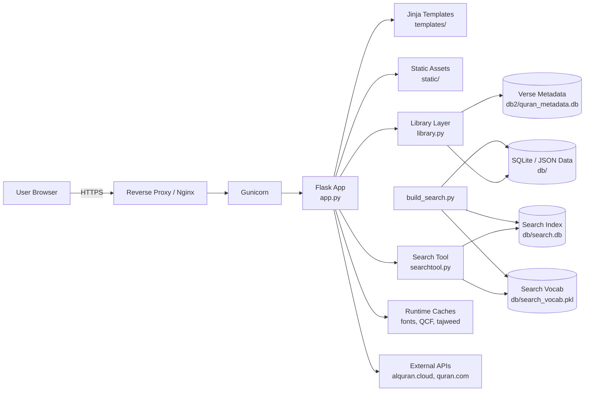

# Aayatun

Aayatun is a Flask web application for reading and exploring the Quran.
The application serves server-rendered pages with Jinja templates and static JavaScript.

Live site: [https://www.aayatun.com](https://www.aayatun.com)

## Overview

Aayatun provides verse reading, mushaf reading, search, tafsir, themes, quiz, reel, and reading-progress tools.
The application uses local SQLite databases and JSON files for most content.
The application does not use a frontend build step.

## Main Pages and Routes

| Page | Route | Purpose |
| --- | --- | --- |
| Home | `/` | Select a surah, verse, page, or feature entry point. |
| Verse details | `/<surah>/<verse>` | Show a verse, translation, tajweed/QCF text, audio, and on-demand sections. |
| Mushaf page | `/page/<page_no>` | Show a Madani mushaf page with table or mushaf-layout view. |
| Arabic surah view | `/arabic/<surah>` | Show Arabic verses for a surah. |
| Translation | `/translation/<surah>` | Show English translation for a surah. |
| English tafsir | `/tafsir/en/<surah>` | Show English tafsir for a surah. |
| Bengali tafsir | `/tafsir/bn/<surah>` | Show Bengali tafsir for a surah. |
| Theme page | `/theme/<theme_id>` | Show verses for an AI-assisted theme. |
| Search | `/search/` (POST) | Search Arabic, English, tafsir, and AI context. |
| Quran Exploration Map | `/map` | Show reading progress across all 6,236 verses. |
| Quiz | `/quiz` | Run a 5-question verse quiz session. |
| Quiz stats | `/quiz/stats` | Show quiz bank statistics. |
| Reel | `/reel/<surah>/<verse>` | Show a word-by-word verse reel. |
| Prayer Time | `/prayer-time` | Show the standalone prayer-time tool. |
| Habit Tracker | `/daily-counter` | Show the standalone habit-tracker tool. |

## Features

### Reading

- Show verse details with translation, audio, word information, and additional sections.
- Show Madani mushaf pages with page navigation, tajweed toggle, and mushaf layout toggle.
- Show surah-wide Arabic, translation, and tafsir views.
- Open verse details in a shared modal from supported pages.

### Search

- Use SQLite FTS5 for full-text search.
- Search Arabic text, English translation, English tafsir, Bengali tafsir, AI context, and surah names.
- Normalize Arabic and Bengali text for matching.
- Use a trigram fallback for substring matching when SQLite supports it.
- Suggest corrections when a query returns no results.

### Quran Exploration Map

- Show one square for each of the 6,236 Quran verses.
- Track visited pages and opened verses in browser local storage.
- Show theme mode, theme legend highlighting, quiz attendance mode, and a fullscreen map view.
- Share a generated map card image.

### Quiz

- Serve quiz sessions from a pre-generated local quiz bank.
- Track quiz history and attendance locally in the browser.
- Show quiz bank coverage on `/quiz/stats`.

### Reel

- Show word-by-word morphology and root information for a verse.
- Support sequential navigation and optional shuffle.
- Share a reel link and card.

### Standalone Tools

- Serve Prayer Time and Habit Tracker as standalone HTML pages.
- Support PWA install flows and service-worker caching.

## Data and Databases

Run the application from the repository root.
The application uses relative data paths such as `db/...` and `db2/...`.

### Tracked Data

| Path | Type | Purpose |
| --- | --- | --- |
| `db/quran.db` | SQLite | Arabic Quran text. |
| `db/en_quran.db` | SQLite | English translation. |
| `db/en_kathir.db` | SQLite | English Ibn Kathir tafsir. |
| `db/bn_zakaria.db` | SQLite | Bengali tafsir. |
| `db/ai_context.db` | SQLite | AI-generated verse context. |
| `db/page_overviews.db` | SQLite | Page context and summary data. |
| `db/surah_overviews.db` | SQLite | Surah context and summary data. |
| `db/ayah_themes.db` | SQLite | Verse theme assignments and theme metadata. |
| `db/verse_quizzes.db` | SQLite | Pre-generated quiz bank. |
| `db/quran_stat.json` | JSON | Surah metadata and statistics. |
| `db/quran_index.txt` | Python literal text | Surah/verse index data. |
| `db/ruku_index.txt` | Python literal text | Ruku index data. |
| `db/sarf.json` | JSON | Morphology support data. |
| `db/qcf_verses.json` | JSON | QCF verse text and mushaf page mapping. |
| `db/mushaf_lines.json` | JSON | Mushaf line layout data. |
| `db/root_meanings.json` | JSON | Root meaning data for reel view. |
| `db/search_synonyms.json` | JSON | Search synonym groups. |
| `db2/quran_metadata.db` | SQLite, Git LFS | Per-verse metadata pickles used by verse routes. |

### Generated or Runtime Data

| Path | Type | Purpose |
| --- | --- | --- |
| `db/search.db` | SQLite, gitignored | FTS5 search index. |
| `db/search_vocab.pkl` | Pickle, gitignored | Vocabulary for "did you mean" suggestions. |
| `db/qcf_cache.db` | SQLite, gitignored | Runtime QCF cache. |
| `db/tajweed_cache.db` | SQLite, gitignored | Runtime tajweed cache. |
| `db/fonts/` | Directory, gitignored | Downloaded page fonts. |

## Run Locally

### Requirements

- Python 3.10 is recommended.
- Git LFS is required for `db2/quran_metadata.db`.
- Install Python dependencies from `requirements.txt`.

### Setup

```bash
git lfs install
git lfs pull

python3.10 -m venv venv
source venv/bin/activate
pip install -r requirements.txt
```

### Start the Development Server

Run this command from the repository root:

```bash
flask --app app.py run --debug
```

Do not run `python3 app.py`.
The file does not define a `__main__` entry point.

### Quick Smoke Check

```bash
python3 -c "import app; print(app.app.test_client().get('/2/255').status_code)"
```

## Build Search Index

The search index is generated from local data files.
Run the command from the repository root.

### Build or Rebuild the Index

```bash
python3 build_search.py
```

This command creates or replaces:

- `db/search.db`
- `db/search_vocab.pkl`

### Build Search Switches

| Switch | Purpose |
| --- | --- |
| `--help` | Show command help. |
| `--add-english-index` | Upgrade an existing search index in place for English stemming support. |
| `--add-root-index` | Add the annotated Arabic root index to an existing search index. |

Use only one upgrade switch at a time.
The upgrade switches require an existing `db/search.db`.

### Search Index Notes

- The build uses local files only.
- The build creates the FTS5 `docs` table.
- The build creates `docs_trgm` when SQLite supports the trigram tokenizer.
- SQLite 3.34 or newer is required for trigram substring fallback.
- If `db/search.db` is missing, `searchtool.index_search()` can build it automatically at runtime.

## Deploy to Server

The production site is deployed at [https://www.aayatun.com](https://www.aayatun.com).
Use these steps for a Linux server deployment.

### 1. Get the Code

```bash
git clone <repository-url>
cd aayatun
git checkout deploy
git lfs install
git lfs pull
```

### 2. Create a Python Environment

```bash
python3.10 -m venv venv
source venv/bin/activate
pip install -r requirements.txt
pip install gunicorn
```

### 3. Set Environment Variables

Set a secret key before you start the application:

```bash
export AAYATUN_SECRET_KEY="<long-random-secret>"
```

Do not commit the secret key to the repository.

### 4. Build the Search Index

```bash
source venv/bin/activate
python3 build_search.py
```

Rebuild or upgrade the index when search source data changes:

```bash
python3 build_search.py
python3 build_search.py --add-english-index
python3 build_search.py --add-root-index
```

### 5. Run with a WSGI Server

Start Gunicorn from the repository root:

```bash
source venv/bin/activate
gunicorn --workers 2 --bind 127.0.0.1:8000 app:app
```

Put a reverse proxy, such as Nginx, in front of Gunicorn.
Configure the reverse proxy to forward HTTPS traffic to `127.0.0.1:8000`.

### 6. Run as a Service

Create a system service, such as `systemd`, for Gunicorn.
Set the working directory to the repository root.
Load `AAYATUN_SECRET_KEY` from a secure environment file.
Restart the service after code or data updates.

### Deployment Checklist

- Pull the latest `deploy` branch.
- Pull Git LFS objects.
- Install or update Python dependencies.
- Rebuild `db/search.db` when search data changes.
- Restart the WSGI service.
- Verify key routes, such as `/`, `/2/255`, `/page/1`, `/map`, and `/search`.

## Architecture Diagram



## Notes

- The repository has no automated test suite and no CI workflow.
- Keep Git LFS installed on development and deployment machines.
- Do not commit generated cache files in `db/fonts/`, `db/qcf_cache.db`, or `db/tajweed_cache.db`.
- The search index files are generated artifacts and can be rebuilt with `python3 build_search.py`.
